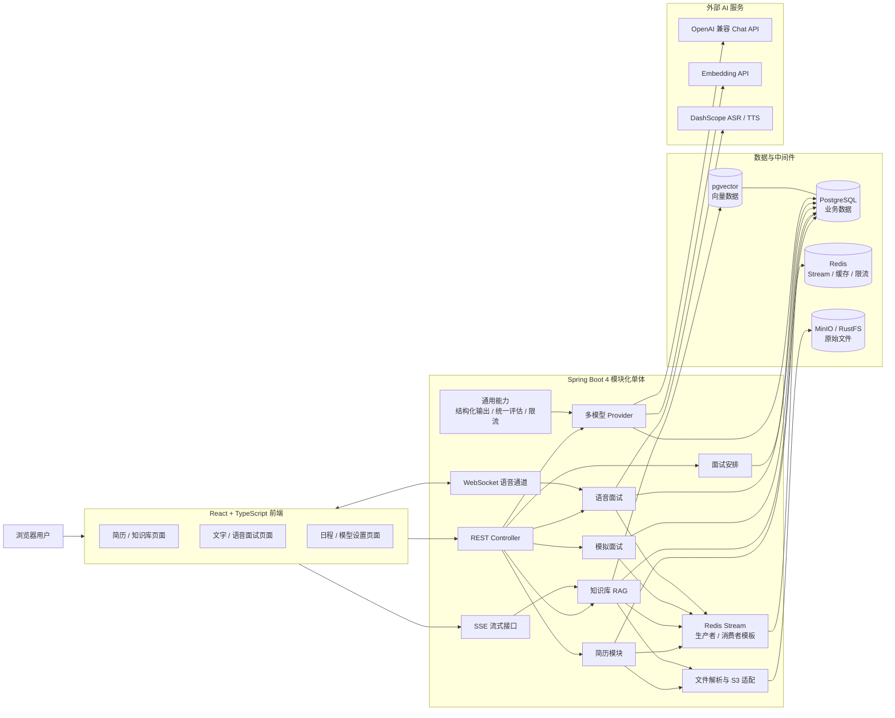
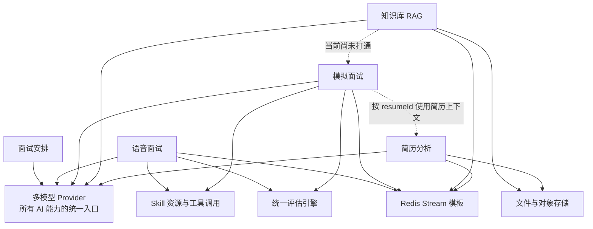
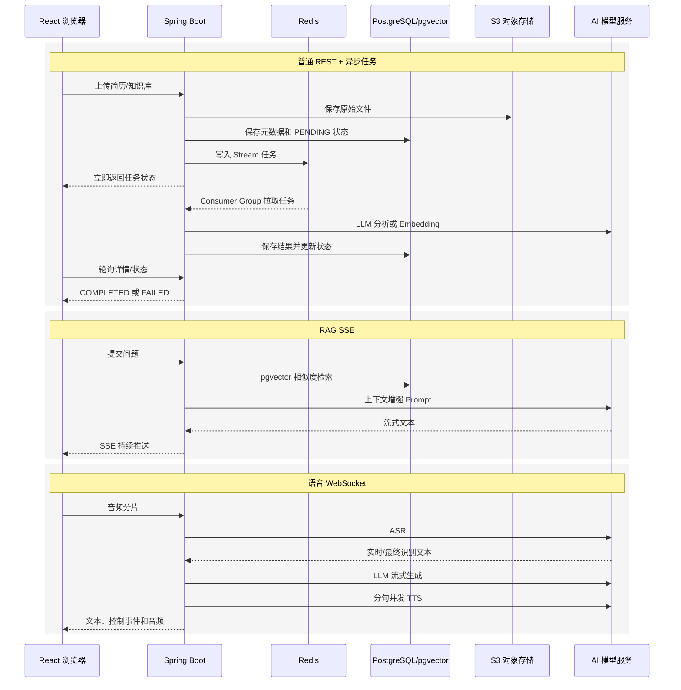

# 第 0 章：项目全景与技术选型

> 学习目标：先建立项目的“全局地图”，理解系统边界、模块关系、核心数据通道和技术选型。后续章节再逐条进入真实代码。

## 完整章节大纲

通读项目结构后，我建议在原计划上增加“面试安排”和“工程化部署”两个独立章节。原因是：面试安排包含“规则优先、AI 兜底”的典型 AI 应用设计；工程化部署则能帮助你证明自己理解的不只是模型调用，还有完整系统落地。

1. `00-项目全景与技术选型.md`
   - 系统定位、总体架构、模块关系、存储边界和核心技术选型。
2. `01-简历分析模块.md`
   - 文件校验、内容哈希去重、Tika 解析、S3 存储、Redis Stream 异步分析、结构化输出和 PDF 导出。
3. `02-知识库RAG模块.md`
   - 文档解析与分块、批量 Embedding、pgvector、临时向量发布、查询改写、动态 TopK/阈值和 SSE 流式问答。
4. `03-模拟面试模块.md`
   - Skill 驱动出题、简历/JD 上下文、历史题目去重、追问、会话状态和报告生成。
5. `04-统一评估引擎.md`
   - 文字与语音共用的分批评估、结构化输出、二次汇总和降级策略。
6. `05-语音面试模块.md`
   - WebSocket、Qwen ASR/TTS、服务端 VAD、多轮上下文、虚拟线程、句子级并发 TTS、暂停恢复和回声防护。
7. `06-面试安排模块.md`
   - 邀约文本的规则解析、AI 兜底、日程状态机、定时过期和日历交互。
8. `07-通用基础设施.md`
   - Redis Stream 模板、可重复注解限流、LLM Provider 注册表、结构化输出、Prompt 安全、异常体系与事务边界。
9. `08-前端交互与工程化部署.md`
   - React 页面/API 组织、轮询/SSE/WebSocket 三类交互、Docker Compose、可观测性、测试和生产化改造。
10. `09-项目面试表达与追问手册.md`
    - 1 分钟/3 分钟项目介绍、个人职责表达、核心难点、常见追问和诚实说明项目边界的方法。

---

## 1. 一句话概括

InterviewGuide 是一个以 Java 为主的 AI 应用工程：它把 LLM、Embedding、RAG、实时语音和传统后端能力组合起来，为简历分析、模拟面试、语音面试、知识库问答和面试日程管理提供完整业务闭环。

它更准确的架构定位是：

> **前后端分离的模块化单体应用 + 多模型 AI 接入层 + Redis 异步任务与缓存 + PostgreSQL/pgvector 统一数据底座 + S3 对象存储。**

这里要特别注意两点：

- 它是 AI Agent 应用项目，但不是“让一个自主 Agent 任意规划并执行所有业务”的通用 Agent 平台。项目中的 Agent 特征主要体现在 Skill、Tool Calling、Advisor、上下文组织和多轮交互。
- 它不是微服务。六个业务模块仍运行在同一个 Spring Boot 进程中、共享一个数据库和同一套基础设施，因此面试时应称为“模块化单体”，不要误称为微服务架构。

---

## 2. 设计思路

### 2.1 系统分层

后端主要分为三层目录：

- `app/src/main/java/interview/guide/modules/`
  - 业务模块层。包含简历、知识库、模拟面试、语音面试、面试安排和多模型配置。
- `app/src/main/java/interview/guide/common/`
  - 跨模块复用能力。包含 AI Provider、结构化输出、统一评估、Redis Stream 模板、限流、异常和统一响应。
- `app/src/main/java/interview/guide/infrastructure/`
  - 外部基础设施适配。包含 S3 文件存储、Tika 文档解析、Redis、PDF 导出和 MapStruct 映射。

典型调用方向是：

`Controller → Service 业务编排 → Repository / common / infrastructure`

这种设计的价值在于：

1. Controller 只处理协议层问题，复杂流程留在 Service。
2. 业务模块不需要重复实现 LLM 调用、异步消费、文件存储和异常处理。
3. 外部技术可以被替换。例如业务层依赖 `FileStorageService` 和 Spring AI 抽象，而不是直接把 MinIO、DashScope SDK 调用散落在每个模块中。

### 2.2 总体架构

### 2.3 六个业务模块的职责和关系

#### 简历分析

- 接收 PDF、Word、TXT 等简历文件。
- 校验大小和类型，基于文件内容判断重复。
- 使用 Apache Tika 提取文本，原文件存入 S3 兼容对象存储。
- 将分析任务投递到 Redis Stream，由消费者异步调用 LLM。
- 分析结果保存到 PostgreSQL，并支持 PDF 报告导出。
- 模拟面试可以通过 `resumeId` 使用简历内容进行针对性出题。

核心入口：`modules/resume/ResumeController.java`

#### 知识库 RAG

- 上传并解析知识文档。
- 文档分块后调用 Embedding 模型，将向量和元数据写入 pgvector。
- 问答时先进行 Query Rewrite，再按问题长度动态决定 TopK 和相似度阈值。
- 将检索片段注入 Prompt，通过 SSE 返回流式答案。

核心入口：

- `modules/knowledgebase/KnowledgeBaseController.java`
- `modules/knowledgebase/RagChatController.java`

#### 模拟面试

- 根据 Skill、难度、简历、JD 和历史题目生成问题。
- 保存会话和答案，支持暂存、提前交卷和继续面试。
- 结束后通过 Redis Stream 异步执行统一评估并生成报告。

核心入口：

- `modules/interview/InterviewController.java`
- `modules/interview/skill/InterviewSkillController.java`

#### 语音面试

- REST 管理会话生命周期，WebSocket 负责实时双向语音数据。
- 处理链路是“用户音频 → ASR → LLM → TTS → AI 音频”。
- 会话结束后同样进入异步评估，并复用统一评估引擎。

核心入口：

- `modules/voiceinterview/controller/VoiceInterviewController.java`
- `modules/voiceinterview/handler/VoiceInterviewWebSocketHandler.java`

#### 面试安排

- 解析飞书、腾讯会议、Zoom 等邀约文本。
- 先使用确定性规则，规则无法得到有效结果时再调用 LLM。
- 管理日程 CRUD 和状态流转，定时将过期日程更新为相应状态。

核心入口：`modules/interviewschedule/InterviewScheduleController.java`

#### 多模型 Provider 管理

- 统一管理聊天模型和 Embedding 模型。
- 根据 Provider 配置动态创建并缓存 Spring AI `ChatClient`、`OpenAiChatModel` 和 `EmbeddingModel`。
- 为普通聊天、严格结构化输出、语音流式 Tool Calling 创建不同类型的 ChatClient。
- 修改默认 Provider 后清理缓存，下一次访问时重新构建客户端。

核心入口：

- `modules/llmprovider/controller/LlmProviderController.java`
- `common/ai/LlmProviderRegistry.java`

### 2.4 模块依赖关系

虚线“当前尚未打通”是一个重要边界：README 的 TODO 明确写有“打通模拟面试和知识库”。因此面试时不能声称模拟面试已经通过 RAG 自动检索知识库出题。当前 Skill 可以带参考资源，但这不等同于完整的动态 RAG 出题链路。

### 2.5 数据存储边界

项目没有把所有数据塞进同一种存储，而是按数据特征拆分：

- PostgreSQL
  - 保存简历元数据与分析结果、面试会话与答案、语音消息与评估、知识库元数据、RAG 会话消息、日程和 Provider 配置。
- pgvector
  - 作为 PostgreSQL 扩展保存文档分块的向量与 JSONB 元数据。
- MinIO / RustFS
  - 保存用户上传的原始简历和知识库文件。
- Redis
  - Redis Stream 承担简历分析、知识库向量化、文字面试评估和语音面试评估四类异步任务。
  - Redisson 还用于会话缓存和 Lua 限流。
- 进程内并发容器
  - 语音 WebSocket 活跃连接、状态和开场音频缓存在当前应用进程的 `ConcurrentHashMap` 中。

这个拆分体现了“结构化业务数据、非结构化文件、向量、短期状态各用合适存储”的思路。

---

## 3. 数据处理流程

### 3.1 用户请求的三种实时交互模式

项目不是所有功能都使用同一种通信方式：

1. 普通 REST
   - 用于上传文件、列表查询、会话创建、答案提交、状态更新和配置管理。
2. SSE
   - 用于 RAG 问答的服务端单向流式输出。
   - 用户问题通过 HTTP 请求发送，模型 Token/片段持续由服务端推给浏览器。
3. WebSocket
   - 用于语音面试的双向实时通信。
   - 浏览器持续上传音频，服务端同时下发识别结果、控制消息、AI 文本和音频。

### 3.2 Redis Stream 异步状态机

四类异步任务共用一套模板化流程：

`PENDING → PROCESSING → COMPLETED`

异常时会重新入队；超过最大重试次数后进入：

`PROCESSING → FAILED`

消费者使用 Consumer Group 拉取新消息，同时通过 pending auto-claim 回收长时间未 ACK 的消息。成功后 ACK；失败时先把带有新 `retryCount` 的任务重新入队，再 ACK 原消息。默认最大重试次数为 3，Stream 最大长度为 1000。

相关代码：

- `common/async/AbstractStreamProducer.java`
- `common/async/AbstractStreamConsumer.java`
- `common/constant/AsyncTaskStreamConstants.java`

### 3.3 AI 调用的统一路径

业务模块不直接固定依赖某一家聊天模型，而是通过：

`LlmProviderRegistry → ChatClient / EmbeddingModel → OpenAI 兼容 API`

需要 JSON 的业务再经过：

`StructuredOutputInvoker → BeanOutputConverter → 校验/重试/指标`

需要防止 Prompt 注入的输入会经过：

`PromptSanitizer → 数据边界标记 → Prompt 模板`

这三层分别解决：

1. 模型供应商可替换。
2. 非确定性的模型文本可转为 Java 结构化对象。
3. 用户文档或邀约文本中的恶意指令不应覆盖系统任务。

---

## 4. 关键代码解析

### 4.1 工程启动与技术依赖

文件：`app/build.gradle`

- Java Toolchain 明确使用 Java 21。
- 使用 Spring Boot WebMVC、JPA、WebSocket、Actuator。
- Spring AI 同时引入 OpenAI 兼容模型和 PgVector Store。
- Redisson 统一连接 Redis。
- Apache Tika 负责文档解析，AWS SDK v2 负责 S3，iText 负责 PDF。
- Prometheus Registry 暴露 Micrometer 指标。

文件：`app/src/main/resources/application.yml`

- `spring.threads.virtual.enabled: true` 全局启用 Spring Boot 虚拟线程支持。
- pgvector 使用 HNSW 索引、余弦距离、1024 维向量。
- RAG 的 Query Rewrite、动态 TopK 和最小分数阈值都可配置。
- 结构化输出的重试、修复型 Prompt、错误长度和指标可配置。
- 语音 ASR 使用服务端 VAD，TTS 并发数和超时可配置。

需要注意：当前本地代码中的默认聊天/向量 Provider 配置为 `openrouter`，README 仍主要以 DashScope 为默认示例。面试表达应说“系统支持运行时配置默认 Provider”，不要把当前默认值说死。

### 4.2 LLM Provider 注册表

文件：`common/ai/LlmProviderRegistry.java`

关键方法：

- `getChatClientOrDefault(providerId)`
  - 指定 Provider 时使用指定模型，否则解析系统默认 Provider。
- `getPlainChatClient(providerId)`
  - 不挂载 Skills Tool，专门用于要求严格 JSON 的出题、评分等场景，避免工具调用消息干扰结构化结果。
- `getVoiceChatClient(providerId)`
  - 启用 Skills Tool 和流式 Tool Calling Advisor，语音历史由业务手动管理。
- `getDefaultEmbeddingModel()`
  - 获取当前默认 Embedding 模型。
- `reload()`
  - 清空 ChatClient、ChatModel 和 EmbeddingModel 缓存，实现配置重载后的延迟重建。

这里使用 `ConcurrentHashMap.computeIfAbsent` 缓存客户端，避免每次业务调用都重新创建模型客户端。

### 4.3 Redis Stream 模板

文件：`common/async/AbstractStreamConsumer.java`

它采用模板方法模式，把消费骨架统一起来，子类只实现：

- 如何解析消息。
- 什么情况下跳过。
- 如何标记处理中、完成和失败。
- 如何执行具体业务。
- 如何构造重试消息。

实际子类包括：

- `modules/resume/listener/AnalyzeStreamConsumer.java`
- `modules/knowledgebase/listener/VectorizeStreamConsumer.java`
- `modules/interview/listener/EvaluateStreamConsumer.java`
- `modules/voiceinterview/listener/VoiceEvaluateStreamConsumer.java`

这比在四个模块复制 while 循环、ACK 和重试逻辑更容易统一修复可靠性问题。

### 4.4 统一评估引擎

文件：`common/evaluation/UnifiedEvaluationService.java`

`evaluate(...)` 的主要过程是：

1. 截断过长简历和参考上下文，控制 Token 成本。
2. 按配置的 batch size 分批评估问答。
3. 使用 `StructuredOutputInvoker` 把模型结果解析为 `BatchReportDTO`。
4. 合并题目结果；缺失结果按 0 分兜底。
5. 再调用一次 LLM 对批次结果进行二次汇总。
6. 汇总失败时退回批次聚合结果。

文字和语音模块复用同一引擎，可以避免两种面试出现评分标准漂移。

### 4.5 RAG 检索链路

文件：`modules/knowledgebase/service/KnowledgeBaseQueryService.java`

`answerQuestionStream(...)` 执行：

1. 更新知识库问题计数。
2. 使用历史对话进行 Query Rewrite。
3. 同时保留“改写问题”和“原始问题”作为候选，改写检索失败时可以回退。
4. 按问题长度选择 TopK 和相似度阈值。
5. 拼接命中文档作为上下文。
6. 调用 Spring AI 流式接口。
7. 对“没有找到相关信息”类输出做探测窗口归一化。

文件：`modules/knowledgebase/service/KnowledgeBaseVectorService.java`

`vectorizeAndStore(...)` 不会直接覆盖旧向量，而是：

1. 新向量先写入带 `pending:` 前缀和 `jobId` 的临时元数据。
2. 所有批次成功后，在事务中删除旧向量并把本次任务提升为正式 `kb_id`。
3. 失败则按 `jobId` 清理临时向量。

这是一种轻量的“分阶段发布”思路，可避免重新向量化到一半时，知识库只剩部分新数据。

### 4.6 语音并发模型

文件：`modules/voiceinterview/handler/VoiceInterviewWebSocketHandler.java`

- `ScheduledThreadPoolExecutor` 只负责用户话语合并和延迟调度。
- LLM、TTS、JDBC 等可能阻塞的工作进入 `Executors.newVirtualThreadPerTaskExecutor()`。
- `ConcurrentWebSocketSessionDecorator` 限制单连接发送时间和缓冲区，降低并发发送导致会话损坏或内存无界增长的风险。
- WebSocket 连接、会话状态和开场音频缓存在当前进程内。

因此，“Java 21 虚拟线程”不是只写在配置文件里，语音主链路也有显式使用。不过 Redis Stream 消费模板当前仍为单个普通守护线程，不能把整个项目描述成“所有线程都是虚拟线程”。

### 4.7 规则优先、AI 兜底

文件：`modules/interviewschedule/service/InterviewParseService.java`

`parse(...)` 先尝试飞书、腾讯会议、Zoom 的正则规则。只有规则没有得到有效结果，才调用 LLM。

这是 AI 应用中很实用的设计：

- 格式明确时，规则更快、更便宜、更可测试。
- 长尾或非标准文本才交给 LLM，提高泛化能力。
- AI 输入先经过 `PromptSanitizer` 和数据边界包装。

---

## 5. 技术亮点与难点

### 5.1 亮点一：AI 能力被工程化，而不是散落的 API 调用

项目把模型接入抽象为 Provider Registry，把结构化输出、Prompt 模板、输入安全、重试和指标做成公共能力。业务代码关心“分析简历”“生成题目”“评估回答”，而不是反复拼接 HTTP 请求。

面试表达：

> 我认为 AI 应用的难点不只是把模型调通，而是处理模型切换、输出不稳定、Prompt 注入、超时失败和可观测性。项目把这些非业务问题沉到公共 AI 层，使业务模块可以复用。

### 5.2 亮点二：四类耗时任务共用可靠异步骨架

简历分析、知识库向量化、文字面试评估和语音面试评估都可能耗时数秒甚至更久。如果同步阻塞 HTTP，请求容易超时，用户也无法看到处理状态。

项目用 Redis Stream 将“接收请求”和“执行 AI 任务”解耦，并统一：

- PENDING/PROCESSING/COMPLETED/FAILED 状态。
- Consumer Group。
- Pending 消息回收。
- 失败重新入队。
- 最大重试次数。
- ACK 和消息裁剪。

### 5.3 亮点三：同一产品内合理组合 REST、SSE 和 WebSocket

- CRUD 使用 REST，简单且语义清晰。
- RAG 只需要服务端持续返回文本，使用 SSE。
- 语音需要同时上传和下发，使用 WebSocket。

这体现了“根据数据方向和实时性选择协议”，而不是为了技术炫技统一使用 WebSocket。

### 5.4 亮点四：RAG 不只是“切块、入库、TopK”

项目还实现了：

- Query Rewrite 与原问题回退。
- 按问题长度动态调整 TopK 和阈值。
- 多知识库元数据过滤及本地过滤兜底。
- 重新向量化的临时数据发布机制。
- 流式无结果回答的归一化。

这些细节比只调用一次 `similaritySearch` 更能体现 RAG 工程经验。

### 5.5 亮点五：统一评估减少业务重复和标准漂移

文字面试和语音面试只负责将自己的对话转换成统一的 `QaRecord`，后续评分走同一个评估服务。分批可以控制 Token，二次汇总保证报告整体性，失败降级保证部分模型调用异常时仍能给出可用报告。

### 5.6 当前实现边界

面试中主动说明边界，反而能体现你确实读过代码：

- 当前是模块化单体，无法独立扩缩某一个消费者。
- Redis Stream 适合当前轻量任务规模，但缺少 Kafka 那样成熟的分区吞吐、长期日志保留和完整消费生态。
- Stream 消息中包含简历或知识库正文；对于接近 50 MB 的文档，这会增加 Redis 内存和网络压力。更稳妥的方案是消息只传资源 ID/对象存储 Key，消费者自行获取正文。
- 语音活跃连接和部分状态在进程内，多实例部署需要会话粘滞或外部化状态，并处理跨实例消息路由。
- `ddl-auto: update` 与 pgvector 自动建表适合开发环境，生产环境应使用 Flyway/Liquibase 管理 Schema。
- Docker Compose 把 MinIO Bucket 设置为公开读；真实生产环境应改为私有桶和短期签名 URL。
- 项目当前未引入 Spring Security，也没有完整用户身份与租户隔离。README 中“求职者、HR、培训机构”是使用场景，不代表角色权限系统已经实现。
- 模拟面试与知识库动态 RAG 仍未真正打通。

---

## 6. 面试问答演练

### 问题一：为什么选择 PostgreSQL + pgvector，而不是 Milvus、Elasticsearch 或专用向量数据库？

参考回答：

> 当前系统的知识库规模和并发量有限，同时已经需要 PostgreSQL 保存简历、会话和日程等关系数据。pgvector 可以让关系数据和向量数据共用一个数据库，减少组件数量和运维成本；项目还可以利用 PostgreSQL 的事务和 JSONB 元数据过滤。代价是超大规模向量检索、复杂混合检索和水平扩展能力不如专用向量数据库。如果数据量增长到千万或亿级，或者需要多副本分片、复杂稀疏稠密混合检索，我会通过压测再评估 Milvus、Qdrant 或 Elasticsearch。

关键点：不是说 pgvector 永远更好，而是它符合当前规模和团队成本。

### 问题二：为什么使用 Redis Stream，而不是 Kafka 或 RabbitMQ？

参考回答：

> 项目本身已经需要 Redis 做缓存和限流，异步任务量不大，主要是简历分析、向量化和评估。Redis Stream 提供 Consumer Group、Pending List、ACK 和消息认领，已经能覆盖当前可靠消费需求，因此可以少部署一个中间件。Kafka 更适合高吞吐、分区并行、长时间事件保留和事件回放；RabbitMQ 在复杂路由、死信和成熟消息治理方面更强。当前选择是降低系统复杂度，不代表 Redis Stream 能替代所有消息队列。

可以继续补充：

> 如果业务增长，我会先把任务消息改成只携带 ID，再增加幂等键、死信流和监控；当吞吐或独立扩容需求超过 Redis Stream 的舒适区时，再迁移到专业 MQ。

### 问题三：为什么 RAG 流式问答用 SSE，而语音面试用 WebSocket？

参考回答：

> RAG 场景的数据主要从服务端单向流向浏览器，SSE 基于 HTTP，断线和代理兼容性更简单，也足以实现打字机效果。语音面试需要浏览器持续上传音频，同时服务端返回 ASR 字幕、LLM 文本、控制事件和 TTS 音频，是双向全双工通信，所以使用 WebSocket。协议选择取决于通信方向，而不是哪个技术更新。

### 问题四：Java 21 虚拟线程在这个项目中解决了什么问题？

参考回答：

> AI 请求、TTS、JDBC 和对象存储都是 I/O 密集操作，传统“一个请求一个平台线程”在大量阻塞等待时会占用较多线程资源。项目在 Spring Boot 配置中开启虚拟线程，语音处理器还显式使用 `newVirtualThreadPerTaskExecutor` 执行 LLM、TTS 和 JDBC 工作，让等待 I/O 的任务可以低成本挂起。它提升的是并发承载和线程使用效率，不会降低外部模型本身的响应延迟，也不能替代超时、限流和背压。

### 问题五：这个项目最像 Agent 的部分在哪里？

参考回答：

> 项目不是完全自治的通用 Agent，而是受业务流程约束的 AI Agent 应用。Agent 特征主要在三个地方：第一，面试方向通过 `SKILL.md` 描述知识范围和行为约束；第二，Spring AI 的 Tool Callback 和 Advisor 让模型可以按场景调用 Skill 能力；第三，语音和文字面试会携带会话上下文进行多轮追问。简历分析、结构化评分和 RAG 检索则更接近确定性 AI Workflow。面试时我会明确区分 Agent 和 Workflow，避免把所有 LLM 调用都包装成 Agent。

### 问题六：系统如何应对 LLM 输出不稳定？

参考回答：

> 对需要 Java 对象的场景，项目使用 `BeanOutputConverter` 提供格式约束，再由 `StructuredOutputInvoker` 统一执行解析、Schema 校验和业务层重试。重试时可以把上一次错误注入修复 Prompt。统一评估还提供两层降级：单批评估失败时为缺失题目补零分结果，二次汇总失败时退回批次聚合结果。这样不会因为一次模型 JSON 格式错误让整个报告完全不可用。

---

## 7. 延伸思考

### 7.1 如果把它改造成可生产部署的多用户系统

优先级较高的改造包括：

1. 增加认证授权和租户隔离
   - 引入 Spring Security、用户/角色模型。
   - 所有简历、知识库、面试和日程数据增加 owner/tenant 约束。
2. 使用数据库迁移工具
   - 用 Flyway 或 Liquibase 替代生产环境 `ddl-auto: update`。
3. 强化异步任务可靠性
   - Stream 消息只传 taskId/resourceId。
   - 增加幂等记录、死信 Stream、重试退避、任务超时和积压告警。
4. 支持多实例语音服务
   - 将可共享会话状态放入 Redis。
   - 使用负载均衡粘滞会话，或引入支持跨节点路由的消息通道。
5. 加强文件安全
   - 私有 Bucket、签名 URL、病毒扫描、扩展名与 Magic Number 双重校验。
6. 完善可观测性
   - 统一记录模型 Provider、Token、费用、首 Token 延迟、检索命中率、异步任务耗时和失败原因。

### 7.2 如果提升 RAG 效果

可以按成本从低到高演进：

1. 保存 chunk 的标题、页码、来源等元数据并在回答中引用。
2. 优化中文分块，增加合理重叠，避免语义在边界处断裂。
3. 增加关键词/BM25 与向量检索的混合召回。
4. 增加 Reranker 对召回片段二次排序。
5. 建立离线评测集，用 Recall@K、MRR、答案忠实度和引用准确率评估，而不是只凭主观体验调整 TopK。

### 7.3 如果提升 AI 调用稳定性与成本控制

- 为不同任务选择不同模型：解析、改写使用小模型，复杂评估使用强模型。
- 设置超时、熔断和 Provider 降级链。
- 对相同文件哈希、相同 Prompt 或重复 Query 做可控缓存。
- 记录 Token 和费用，按模块建立预算。
- 对模型输出做更严格的业务校验，而不只是 JSON Schema 校验。

### 7.4 你在面试中应该如何定位这个项目

建议把它介绍为：

> 这是一个面向求职场景的 Java AI 应用工程。我重点学习和理解了三类问题：第一，如何用 Spring AI 统一接入多种模型并处理结构化输出；第二，如何用 Redis Stream、pgvector、S3 把耗时 AI 任务和多模态数据工程化；第三，如何根据场景组合 REST、SSE 和 WebSocket，完成从文件上传、RAG 检索到实时语音面试的端到端流程。

不要只列技术名词。至少选择两条你能从入口讲到落库的链路，例如：

- 简历上传 → 去重/解析 → S3/数据库 → Redis Stream → LLM 结构化分析 → 状态回写。
- 文档上传 → 分块/Embedding → pgvector → Query Rewrite → 动态检索 → Prompt 增强 → SSE 输出。
- 音频上传 → ASR/VAD → 上下文 LLM → 分句 TTS → WebSocket 下发 → 异步统一评估。

---

下一章预告：第 1 章将沿着一次真实简历上传请求，逐行追踪从文件校验、哈希去重、Tika 解析和 S3 存储，到 Redis Stream 异步分析、结构化评分及 PDF 导出的完整链路。
