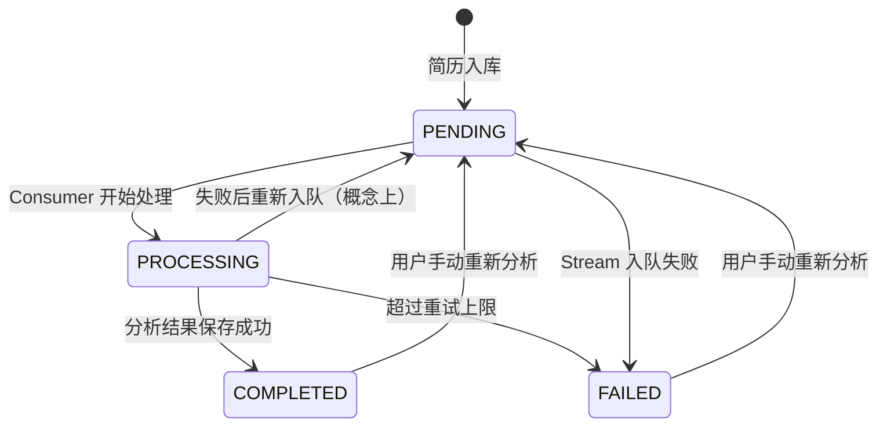
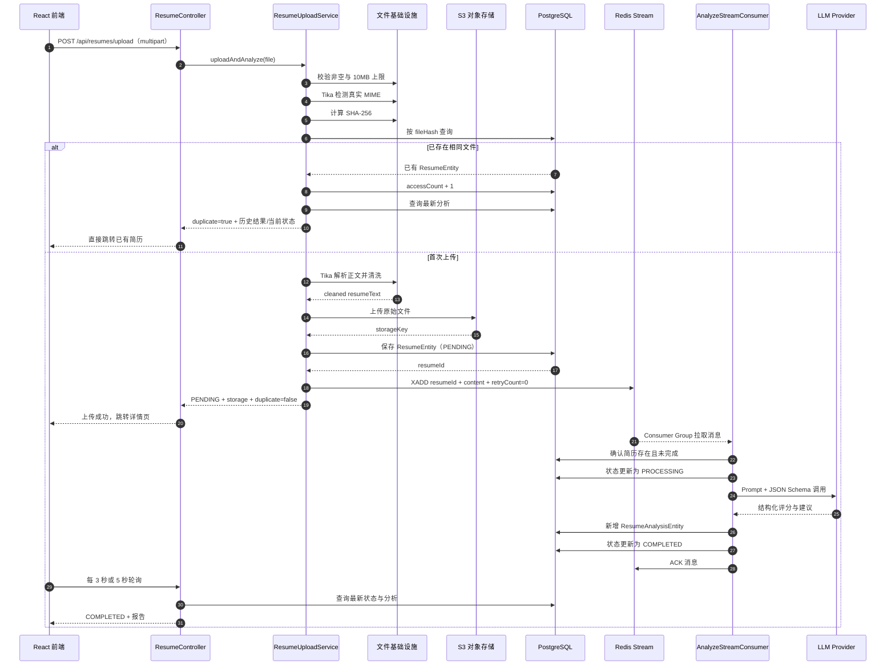
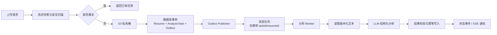

# 第 1 章：简历分析模块

> 学习目标：沿着一次真实的简历上传请求，理解文件校验、内容去重、文档解析、对象存储、异步 AI 分析、状态轮询、历史记录和 PDF 导出的完整链路。

## 1. 一句话概括

简历分析模块把用户上传的 PDF、Word 或文本文件转换为可追踪的异步 AI 任务：同步阶段完成校验、解析、存储和入库，异步阶段调用 LLM 生成结构化评分，最终由前端轮询状态并展示或导出分析报告。

核心价值不是“调用一次大模型”，而是把不稳定、耗时的 AI 分析包装成一个有文件去重、状态机、重试、持久化和失败处理的后端业务流程。

---

## 2. 设计思路

### 2.1 为什么拆成同步阶段和异步阶段

简历上传包含两类操作：

- 必须在请求返回前完成的操作
  - 文件是否为空。
  - 文件是否超过 10 MB。
  - 文件真实 MIME 类型是否合法。
  - 是否为重复文件。
  - 是否能提取出有效文本。
  - 原文件是否成功保存。
  - 简历元数据是否成功入库。
- 不适合阻塞 HTTP 请求的操作
  - 调用外部 LLM。
  - 等待模型生成完整 JSON。
  - 结构化解析和重试。
  - 保存分析结果。

因此，`ResumeUploadService.uploadAndAnalyze(...)` 只负责完成前一组操作，然后向 Redis Stream 投递任务并立即返回 `PENDING`。前端跳转到简历详情或历史页，通过轮询看到状态从 `PENDING` 变为 `PROCESSING`，最后进入 `COMPLETED` 或 `FAILED`。

这样做的收益：

1. 用户不需要让一次 HTTP 上传请求等待几十秒。
2. LLM 抖动不会直接造成网关超时。
3. 分析消费者可以与上传请求解耦。
4. 状态保存在数据库中，刷新页面后仍能继续查看。
5. 失败任务可以重新入队，用户也可以手动重新分析。

### 2.2 为什么同时使用 PostgreSQL 和 S3

简历数据被分为三部分：

- 原始二进制文件
  - 存入 MinIO/RustFS 等 S3 兼容对象存储。
  - PostgreSQL 只保存 `storageKey` 和 `storageUrl`。
- 解析后的纯文本
  - 存入 `resumes.resumeText`。
  - 用于异步分析、重新分析和后续模拟面试出题。
- 结构化分析结果
  - 存入 `resume_analyses`。
  - 数值评分使用独立列，优势和建议暂以 JSON 字符串保存。

这样可以避免把大二进制文件存入关系数据库，同时保留结构化查询、状态跟踪和历史分析能力。

### 2.3 为什么使用文件内容哈希去重

项目对原始文件字节计算 SHA-256：

`原始文件字节 → SHA-256 → 64 位十六进制字符串`

`resumes.fileHash` 同时设置了唯一约束和唯一索引。相同文件即使改了文件名，只要字节完全相同，哈希仍相同，可以直接复用历史记录，避免：

- 重复占用对象存储。
- 重复调用 LLM。
- 重复消耗 Token 和费用。

这里的去重是“二进制完全一致去重”，不是“内容语义去重”。如果用户只是修改了 PDF 元数据、重新导出或改变排版，即使文本相同，文件字节也可能不同，系统仍会视为新文件。

### 2.4 为什么保留多次分析历史

`ResumeEntity` 与 `ResumeAnalysisEntity` 是一对多的逻辑关系：同一份简历可以手动重新分析，并生成新的 `resume_analyses` 记录。

读取列表时使用最新一条分析结果作为当前分数；读取详情时返回全部分析历史。这使系统可以：

- 保留不同时间或不同模型产生的结果。
- 支持分析效果对比。
- 避免重新分析直接覆盖旧报告。

不过当前分析表没有保存 Provider、模型名、Prompt 版本等信息，后续很难准确解释两次评分为何不同，这是值得改进的地方。

### 2.5 状态机设计

代码中重试入队时并没有把数据库状态重新设置为 `PENDING`，状态通常仍显示为 `PROCESSING`，直到新消息成功或最终失败。因此图中的 `PROCESSING → PENDING` 是逻辑任务阶段，不完全等同于数据库字段的真实变化。

---

## 3. 数据处理流程

### 3.1 首次上传的完整流程

### 3.2 同步上传阶段逐步拆解

入口：

`POST /api/resumes/upload`

对应方法：

`ResumeController.uploadAndAnalyze(...)`

处理顺序如下。

#### 第一步：接口限流

上传接口叠加了两个可重复 `@RateLimit`：

- 全局维度：`count = 5`。
- IP 维度：`count = 5`。

注解没有显式设置窗口，因此使用注解默认窗口。控制器注释说明当前默认是 1 秒，而不是“每分钟 5 次”。面试时应以注解真实配置和默认值为准，不要照搬过时注释。

#### 第二步：基础校验

`FileValidationService.validateFile(...)` 检查：

- `file.isEmpty()`。
- 文件是否超过业务层的 10 MB。

Spring 的全局 Multipart 上限是 50 MB，但简历模块又设置了 10 MB 业务上限。两层限制分别服务于：

- Web 容器层：阻止特别大的请求进入业务层。
- 业务层：针对简历设置更严格规则，同时允许知识库上传到 50 MB。

#### 第三步：内容类型检测

`ContentTypeDetectionService.detectContentType(...)` 使用 Apache Tika 读取文件签名，并结合原始文件名推断 MIME。

这比直接相信浏览器提交的 `MultipartFile.getContentType()` 更可靠，因为 HTTP Content-Type 可以被客户端伪造。

实际简历白名单来自 `application.yml`：

- `application/pdf`
- `application/msword`
- `application/vnd.openxmlformats-officedocument.wordprocessingml.document`
- `text/plain`

因此，虽然部分 JavaDoc 写了支持 Markdown，当前简历配置和前端 `accept` 并未开放 `.md`；知识库模块才单独支持 Markdown 扩展名兜底。面试时不要说简历上传已经支持 Markdown。

#### 第四步：SHA-256 去重

`ResumePersistenceService.findExistingResume(...)`：

1. 计算文件 SHA-256。
2. 调用 `ResumeRepository.findByFileHash(...)`。
3. 命中时增加 `accessCount` 并刷新 `lastAccessedAt`。
4. 返回已有简历，不再解析、上传和调用 LLM。

重复响应有两种形式：

- 已经有分析结果：返回 `analysis + storage + duplicate=true`。
- 还没有分析结果：返回 `resume 当前状态 + storage + duplicate=true`。

前端上传页主要使用 `storage.resumeId` 跳转，因此两种结构都能进入同一份简历详情。

#### 第五步：文档解析与文本清洗

调用链：

`ResumeParseService.parseResume(...)`

→ `DocumentParseService.parseContent(...)`

→ `AutoDetectParser`

→ `TextCleaningService.cleanText(...)`

Tika 解析的关键配置：

- `BodyContentHandler` 最大文本长度为 5 MB。
- 不解析内嵌图片和附件。
- PDF 关闭内嵌图片提取。
- PDF 按页面坐标排序文本，改善多栏简历的阅读顺序。
- 只取正文，不把作者、创建时间等文档元数据混入 Prompt。

文本清洗会移除：

- 控制字符。
- 单独一行的图片文件名。
- 图片 URL。
- `file://` 临时路径。
- 符号分隔线。
- 多余行尾空格和连续空行。

扫描版 PDF 没有文本层时，当前系统不会执行 OCR，而是返回“无法提取文本”的错误。这是项目明确的能力边界。

#### 第六步：保存原始文件

`FileStorageService.uploadResume(...)` 使用 AWS SDK v2 调用 S3 兼容接口。

对象 Key 格式：

`resumes/{yyyy/MM/dd}/{8位UUID}_{安全文件名}`

中文文件名被转换为无声调拼音，其他不安全字符替换为下划线。日期路径方便运维查看，UUID 降低同名覆盖风险。

#### 第七步：保存简历元数据

`ResumePersistenceService.saveResume(...)` 保存：

- 文件哈希。
- 原始文件名。
- 文件大小和 Content-Type。
- S3 Key 和 URL。
- 清洗后的简历文本。
- 默认分析状态 `PENDING`。

`fileHash` 同时有数据库唯一约束，避免并发上传相同文件时仅靠“先查再写”产生重复行。

#### 第八步：投递 Redis Stream

`AnalyzeStreamProducer.sendAnalyzeTask(...)` 写入：

- Stream：`resume:analyze:stream`
- `resumeId`
- `content`：完整简历文本
- `retryCount=0`

Stream 写入成功后，HTTP 请求返回。写入失败时，生产者通过 `TransactionalExecutor.runRequiresNew(...)` 开启独立事务，将简历状态更新为 `FAILED` 并记录错误。

这个细节避免了“数据库永远停在 PENDING，但实际上消息根本没有进入队列”。

### 3.3 异步消费阶段

`AnalyzeStreamConsumer` 继承 `AbstractStreamConsumer`。

#### 消息拉取

应用启动后，消费者：

1. 创建唯一消费者名，如 `analyze-consumer-a1b2c3d4`。
2. 创建或确认 `analyze-group`。
3. 使用单线程守护线程循环消费。
4. 先 auto-claim 超过 5 分钟未 ACK 的 Pending 消息。
5. 再读取从未投递的新消息。

#### 幂等跳过

`shouldSkip(...)` 在以下情况直接 ACK：

- 简历已经是 `COMPLETED`。
- 简历已经被删除。

这是基础的重复消费保护，但不是严格的任务幂等。多个不同消息同时指向同一份未完成简历时，仍可能产生多条分析记录。

#### 调用 AI

`ResumeGradingService.analyzeResume(...)`：

1. 加载 `resume-analysis-system.st`。
2. 将 `resumeText` 填入 `resume-analysis-user.st`。
3. 使用 `BeanOutputConverter<ResumeAnalysisResponseDTO>` 生成格式约束。
4. 从 `LlmProviderRegistry` 获取默认 ChatClient。
5. 通过 `StructuredOutputInvoker` 调用模型。
6. 将中间 DTO 转为业务 `ResumeAnalysisResponse`。

当前 Prompt 的实际评分结构是：

- 项目经验：40 分。
- 技能匹配：20 分。
- 内容完整：15 分。
- 结构清晰：15 分。
- 表达专业：10 分。

Java DTO、实体和前端 TypeScript 中部分注释仍写着旧的 `15/25/25/20/15` 分配，但 PDF 导出和当前 Prompt 已使用 `40/20/15/15/10`。这是注释与真实业务规则不一致，学习和面试时应以当前 Prompt 与 PDF 实现为准。

#### 结构化输出重试

`StructuredOutputInvoker` 会：

- 在系统 Prompt 后附加反 Prompt 注入指令。
- 使用 Spring AI Entity Schema 校验。
- 默认最多调用 2 次。
- 第二次可附加严格 JSON 指令。
- 可把上次解析错误的截断版本放进修复 Prompt。
- 记录调用次数、每次尝试结果和延迟指标。

这里的“结构化输出重试”和“Redis Stream 业务重试”是两层不同机制：

- 内层重试：同一条消费任务内，修复模型 JSON。
- 外层重试：整个消费业务抛异常后，重新投递 Redis 消息。

#### 保存结果和 ACK

分析结果通过 MapStruct 映射为 `ResumeAnalysisEntity`：

- 五个评分和摘要映射到普通列。
- `strengths` 和 `suggestions` 手动序列化为 JSON 文本。
- 新记录关联 `ResumeEntity`。

保存成功后：

1. 状态设置为 `COMPLETED`。
2. ACK 当前 Stream 消息。

发生异常时：

1. 如果 `retryCount < 3`，重新写入一条新消息。
2. 新消息的 `retryCount + 1`。
3. ACK 原消息。
4. 当 `retryCount == 3` 仍失败时，将状态标记为 `FAILED`。

所以执行次数最多是“首次 1 次 + 重新入队 3 次”，也就是最多 4 次完整业务尝试。

### 3.4 前端状态同步

上传成功后，`UploadPage.tsx` 读取 `storage.resumeId` 并跳转。

前端采用条件轮询：

- `HistoryPage.tsx`
  - 只要列表中存在 `PENDING` 或 `PROCESSING`，每 3 秒刷新列表。
- `ResumeDetailPage.tsx`
  - 当前简历仍在处理时，每 5 秒静默刷新详情。
- 进入 `COMPLETED` 或 `FAILED` 后停止轮询。

相比固定永久轮询，这样可以减少无意义请求。相比 WebSocket/SSE，它实现简单，适合低频、秒级完成的后台任务。

### 3.5 手动重新分析

入口：

`POST /api/resumes/{id}/reanalyze`

流程：

1. 从数据库读取 `resumeText`。
2. 如果文本为空，从 S3 下载原文件并重新解析。
3. 在小事务中把状态重置为 `PENDING`，清空错误。
4. 事务提交后再投递 Stream。

“事务提交后再发送消息”很重要。如果先发送消息再提交数据库，消费者可能提前读取任务，却看不到最新状态或文本。

重新分析不会删除旧分析记录，成功后详情页会多出一条新的分析历史。

### 3.6 PDF 导出

入口：

`GET /api/resumes/{id}/export`

处理流程：

1. 查询简历。
2. 查询最新分析结果。
3. 反序列化优势和建议。
4. 调用 `PdfExportService.exportResumeAnalysis(...)`。
5. 使用 iText 在内存中生成 `byte[]`。
6. 设置 `Content-Disposition` 和 `application/pdf` 返回浏览器。

PDF 内嵌 `ZhuqueFangsong-Regular.ttf`，使用 `IDENTITY_H` 编码和强制字体嵌入，解决服务器没有中文字体或跨平台乱码的问题。

报告包括：

- 文件名与上传时间。
- 总分。
- 五个维度评分。
- 简历摘要。
- 优势亮点。
- 分优先级的改进建议。

### 3.7 删除流程

`ResumeDeleteService.deleteResume(...)` 按顺序：

1. 尝试删除 S3 原文件。
2. 删除关联模拟面试会话及答案。
3. 删除分析历史。
4. 删除简历记录。

对象存储删除失败时只记录警告，数据库删除仍继续。这保证用户侧记录可以删除，但可能留下 S3 孤儿文件。

---

## 4. 关键代码解析

### 4.1 HTTP 入口：`ResumeController`

路径：

`app/src/main/java/interview/guide/modules/resume/ResumeController.java`

关键方法：

- `uploadAndAnalyze(...)`
  - 接收 Multipart 文件，叠加全局/IP 限流。
- `getAllResumes()`
  - 返回最新分数、异步状态和面试次数。
- `getResumeDetail(id)`
  - 返回简历文本、全部分析历史和关联面试历史。
- `reanalyze(id)`
  - 手动触发重新分析。
- `exportAnalysisPdf(id)`
  - 返回 PDF 二进制。
- `deleteResume(id)`
  - 删除文件、面试和分析数据。

### 4.2 业务编排：`ResumeUploadService`

路径：

`app/src/main/java/interview/guide/modules/resume/service/ResumeUploadService.java`

`uploadAndAnalyze(...)` 是同步阶段的主编排器。它没有添加一个覆盖全流程的大事务，这是合理的，因为 Tika、S3 和 Redis 都是外部或耗时操作，不应该占用数据库连接并长期持有事务。

但这也意味着它依赖操作顺序和补偿逻辑保证最终一致性，而当前补偿还不完整：

- S3 上传成功但数据库保存失败，会留下孤儿对象。
- 数据库保存成功但 Stream 发送失败，已有补偿：状态标记为 `FAILED`。

### 4.3 文档解析：`DocumentParseService`

路径：

`app/src/main/java/interview/guide/infrastructure/file/DocumentParseService.java`

它是简历和知识库共享的通用能力。核心不是简单的 `new Tika().parseToString()`，而是显式配置：

- `AutoDetectParser`
- `BodyContentHandler`
- `ParseContext`
- 禁止嵌入资源解析
- `PDFParserConfig`

这种封装把解析策略集中在基础设施层，知识库模块不必复制一份。

### 4.4 文件去重：`FileHashService`

路径：

`app/src/main/java/interview/guide/infrastructure/file/FileHashService.java`

项目同时提供：

- `calculateHash(MultipartFile)`：当前业务使用，会调用 `file.getBytes()`。
- `calculateHash(InputStream)`：按 8 KB 分块计算，但当前上传流程尚未使用。

简历最多 10 MB，当前一次性读取尚可接受。不过上传流程会在“查重”和“保存实体”时分别计算一次哈希，相当于重复读取和计算；可以在编排层只算一次并向后传递。

### 4.5 对象存储：`FileStorageService`

路径：

`app/src/main/java/interview/guide/infrastructure/file/FileStorageService.java`

它对业务屏蔽了 S3 SDK：

- `uploadResume(...)`
- `downloadFile(...)`
- `deleteResume(...)`
- `fileExists(...)`
- `getFileUrl(...)`

因此本地可以使用 MinIO/RustFS，生产环境也可以更换为其他 S3 兼容存储，而不需要改简历 Service。

### 4.6 生产者：`AnalyzeStreamProducer`

路径：

`app/src/main/java/interview/guide/modules/resume/listener/AnalyzeStreamProducer.java`

它继承 `AbstractStreamProducer`，只负责定义：

- Stream Key。
- 消息字段。
- 负载标识。
- 入队失败后的业务补偿。

`onSendFailed(...)` 使用 `REQUIRES_NEW` 很值得面试时说明：即使调用方未来处在一个将回滚的事务里，失败状态仍可以用独立事务落库。

### 4.7 消费者：`AnalyzeStreamConsumer`

路径：

`app/src/main/java/interview/guide/modules/resume/listener/AnalyzeStreamConsumer.java`

它实现模板方法：

- `parsePayload(...)`
- `shouldSkip(...)`
- `markProcessing(...)`
- `processBusiness(...)`
- `markCompleted(...)`
- `markFailed(...)`
- `retryMessage(...)`

业务核心只有：

`gradingService.analyzeResume(content) → persistenceService.saveAnalysis(...)`

其余消费循环、Pending 回收、ACK 和异常骨架均来自公共父类。

### 4.8 结构化评分：`ResumeGradingService`

路径：

`app/src/main/java/interview/guide/modules/resume/service/ResumeGradingService.java`

Prompt 不写在 Java 字符串中，而是位于：

- `app/src/main/resources/prompts/resume-analysis-system.st`
- `app/src/main/resources/prompts/resume-analysis-user.st`

这样可以独立调整角色、评分标准和输入模板。

`BeanOutputConverter` 只负责把输出约束为中间 DTO，随后 `convertToResponse(...)` 再转换为业务模型。这避免 AI 输出对象直接与 JPA Entity 耦合。

### 4.9 持久化与映射

路径：

- `modules/resume/service/ResumePersistenceService.java`
- `infrastructure/mapper/ResumeMapper.java`
- `modules/resume/model/ResumeEntity.java`
- `modules/resume/model/ResumeAnalysisEntity.java`

MapStruct 处理稳定的普通字段，Jackson 处理集合 JSON。这种混合方式可用，但 `strengthsJson` 和 `suggestionsJson` 存为 TEXT 会降低数据库内查询能力；PostgreSQL 项目可以考虑改为 `jsonb`。

---

## 5. 技术亮点与难点

### 5.1 基于内容的去重与数据库唯一约束

亮点不只是“算 SHA-256”，而是应用层查重和数据库唯一约束共同工作：

- 应用层提前命中，改善用户体验并节省成本。
- 数据库唯一约束处理并发竞争，保证最终不出现重复哈希记录。

面试表达：

> 我用文件内容 SHA-256 而不是文件名去重，因为文件名可以随意修改。应用层先查历史结果减少解析和 LLM 成本，数据库唯一约束再兜住并发上传。

### 5.2 文档解析的资源控制和质量优化

- Tika 支持多格式。
- 文本上限防止解析结果无限增长。
- 跳过内嵌资源减少临时文件、内存和噪声。
- PDF 按位置排序改善多栏简历。
- 清洗层提高后续 Prompt 输入质量。

### 5.3 两层重试与异步状态追踪

理论设计上存在两层：

- JSON 解析失败：`StructuredOutputInvoker` 内部重试。
- 完整业务失败：Redis Stream 重新入队。

状态机让前端和用户能区分待处理、处理中、成功和失败，而不是只得到一个 HTTP 超时。

### 5.4 外部调用不占用数据库长事务

Tika、S3、Redis 和 LLM 调用没有放进一个大事务中。只有保存实体、状态更新等短数据库操作进入事务。

这是后端开发中非常重要的原则：

> 数据库事务只能保证数据库资源，无法回滚已经完成的 S3 上传或 LLM 调用。把外部调用放在事务里不仅不能获得真正原子性，还会长时间占用连接和锁。

### 5.5 历史结果与手动恢复能力

- 重复上传可以复用结果。
- 失败后可以手动重新分析。
- 重新分析保留历史版本。
- 没有缓存文本时可以从 S3 恢复原文件重新解析。

这使模块不只是一次性 Demo，而具备一定运维和恢复能力。

### 5.6 必须说明的真实实现问题

#### 问题一：AI 失败可能被标记为成功

`ResumeGradingService.analyzeResume(...)` 最外层捕获所有异常，并返回一个 0 分的 `createErrorResponse(...)`。

结果是：

1. AI 调用或结构化解析彻底失败。
2. GradingService 不再向上抛异常。
3. Consumer 把 0 分错误报告正常保存。
4. Consumer 调用 `markCompleted(...)`。
5. Redis 外层 3 次重试不会触发。

因此，README 所说的“分析失败自动重试最多 3 次”在当前代码中对真正的 LLM 分析异常并不完全生效。外层重试更可能覆盖持久化等仍会抛出的异常。

合理改法是二选一：

- 严格模式：AI 最终失败时继续抛 `BusinessException`，让 Stream 重试并最终标记 `FAILED`。
- 降级模式：保留 0 分报告，但增加 `degraded=true` 或独立状态，不能标为正常 `COMPLETED`。

#### 问题二：评分标准注释不一致

当前 Prompt 和 PDF 使用 `40/20/15/15/10`，但 Java record、Entity 和 TypeScript 注释仍写旧分值。并且代码没有显式校验每个分数是否越界、总分是否与各维度之和一致。

生产化应：

- 把评分权重放入统一配置或领域常量。
- Prompt、校验器、PDF 和前端都读取同一来源。
- 对模型结果增加范围和总分一致性校验。

#### 问题三：跨存储一致性没有完整补偿

上传顺序是：

`S3 上传 → 数据库保存 → Redis 入队`

- 数据库保存失败时，没有自动删除刚上传的 S3 文件。
- S3 删除失败时，删除数据库仍继续。

这是典型的跨资源最终一致性问题，不能用单个 `@Transactional` 解决。可以增加补偿任务或 Outbox/任务表。

#### 问题四：Redis 消息携带完整简历文本

优点是消费者不需要再查库；缺点是：

- Redis 内存占用增加。
- 网络传输重复。
- Pending 和重试会保留多份正文。
- 简历内容属于敏感个人信息，进入更多存储面。

更合适的消息通常只包含：

`taskId + resumeId + textVersion`

消费者再从数据库读取文本，并进行版本和幂等校验。

#### 问题五：列表查询存在 N+1 风险

`ResumeHistoryService.getAllResumes()` 先查询所有简历，然后对每份简历分别：

- 查询最新分析。
- 查询关联面试列表并计算数量。

简历数量增加后会产生约 `1 + 2N` 次查询。应改为投影查询、批量查询或数据库聚合。

---

## 6. 面试问答演练

### 问题一：请完整介绍一次简历上传是怎么处理的

参考回答：

> 前端通过 Multipart 请求上传文件，Controller 先经过全局和 IP 两个维度限流。Service 校验空文件和 10 MB 上限，然后用 Tika 基于文件内容检测 MIME，避免完全信任客户端头。接着计算 SHA-256 查重，重复文件直接返回历史结果。新文件通过 Tika 提取正文并清洗，原文件写入 S3，元数据和文本写入 PostgreSQL，状态设为 PENDING。之后向 Redis Stream 写入分析任务并立即响应。消费者通过 Consumer Group 拉取任务，把状态改成 PROCESSING，调用 Spring AI 获得结构化评分，结果入库后改为 COMPLETED 并 ACK。前端在分析期间按 3 秒或 5 秒轮询状态。

### 问题二：为什么不在上传接口中同步调用 LLM？

参考回答：

> LLM 延迟高且不稳定，同步调用会让上传请求长时间占用连接，并容易受到网关超时影响。异步化后，上传接口只负责可靠接收文件和创建任务，模型失败可以独立重试，用户刷新页面也能从数据库继续看到状态。代价是前端需要轮询或推送机制，并且系统必须处理消息幂等和跨存储一致性。

### 问题三：文件去重为什么用 SHA-256？有没有缺点？

参考回答：

> 文件名不能作为去重依据，因为用户可以改名。SHA-256 碰撞概率极低，适合作为内容指纹，并且数据库上还有唯一约束。但它只能判断二进制完全相同，重新导出的 PDF 即使文字相同也可能产生不同哈希。如果产品需要语义级去重，可以对清洗后的文本再做规范化哈希，或者使用 SimHash/Embedding 相似度作为提示，但不能轻易自动合并，避免误判。

### 问题四：Redis Stream 是如何保证失败恢复的？

参考回答：

> 消费者使用 Consumer Group。消息处理前不会 ACK，如果进程中途崩溃，消息会留在 Pending List，空闲超过 5 分钟后可被其他消费者 auto-claim。业务抛异常时，系统会把带递增 retryCount 的新消息重新入队，再 ACK 原消息；最多重新入队 3 次，最终失败写入数据库状态。对于重复投递，消费者会跳过已 COMPLETED 或已删除的简历。不过当前幂等只做到状态级，若并发存在多个未完成任务，还需要 taskId 或唯一分析版本进一步加强。

### 问题五：结构化输出为什么仍需要重试？

参考回答：

> 即使 Prompt 要求 JSON，模型仍可能输出 Markdown 包裹、遗漏字段、类型错误或字符串引号未转义。项目用 BeanOutputConverter 提供 Schema，再通过 StructuredOutputInvoker 做 Schema 校验、修复型 Prompt 和最多两次尝试。这里的重试只针对单次 AI 结构化调用，和 Redis 的完整任务重试是两个层次。

### 问题六：文件、数据库和消息队列如何保证一致性？

参考回答：

> 当前项目采用有序操作和部分补偿，而不是分布式事务。先上传 S3，再保存数据库，最后发送 Stream；消息发送失败时会用独立事务把状态标记为 FAILED。但数据库保存失败后的 S3 孤儿文件还没有补偿，因此不能声称已经做到强一致。生产环境我会考虑任务表加 Outbox：数据库事务内同时保存简历和待发送事件，由后台可靠投递；S3 孤儿文件则通过补偿记录或定期扫描清理。

### 问题七：为什么原文件存 S3，解析文本还要存数据库？

参考回答：

> S3 适合二进制大对象，数据库适合业务查询和状态关联。保存解析文本可以让重新分析和面试出题不必每次下载并重新解析文件，也方便事务内读取。但文本中有个人隐私，生产环境需要权限控制、加密、脱敏和数据保留策略。

### 问题八：如何处理扫描版 PDF？

参考回答：

> 当前 Tika 只能提取有文本层的 PDF，扫描版会得到空文本并返回解析失败。合理的增强方案是先用 Tika，检测文本为空或质量过低后再进入 OCR，例如 PaddleOCR 或云 OCR；不建议所有 PDF 都默认 OCR，因为成本和延迟更高。OCR 结果还需要版面分析和置信度控制。

---

## 7. 延伸思考

### 7.1 建议的生产级上传架构

主要改进：

1. 哈希改为流式计算，避免多次 `getBytes()`。
2. 增加病毒扫描和压缩炸弹防护。
3. S3 使用私有桶和签名 URL。
4. 消息只传 ID，不传简历全文。
5. 使用任务表和 Outbox 保证数据库事件可靠发送。
6. 分析结果带 `taskId` 唯一约束，保证幂等。
7. 记录 Prompt、Provider、模型版本、Token、耗时和是否降级。
8. 使用 SSE 推送状态，或在规模较小时继续使用带退避的轮询。

### 7.2 Prompt 与评分结果校验

除了 JSON Schema，还应做业务校验：

- `overallScore` 必须在 0 到 100。
- 每个维度不能超过对应上限。
- 各维度之和应等于总分，或明确定义总分独立计算。
- `priority` 只能是高、中、低。
- 建议数量设置合理上下限。
- 输出中的量化成果不能被模型当成候选人的真实经历自动补写。

### 7.3 隐私与安全

简历包含姓名、手机号、邮箱、教育和工作经历。生产环境至少需要：

- HTTPS。
- 数据库字段和对象存储服务端加密。
- 私有 Bucket 和短期签名 URL。
- 用户级数据隔离。
- 日志禁止打印全文和敏感字段。
- 明确保存期限与删除策略。
- 向第三方模型发送前进行用户授权和必要脱敏。
- 删除时处理数据库、对象存储、消息和模型侧缓存等所有副本。

### 7.4 性能优化顺序

不要一开始就引入复杂中间件，可以按真实指标演进：

1. 修复列表页 N+1 查询。
2. 哈希只计算一次。
3. 消息只传 ID。
4. 对消费者增加可配置并发和队列积压指标。
5. 为 LLM 设置超时、熔断和供应商降级。
6. 大文件解析改为独立 Worker，并限制 CPU、内存和执行时间。
7. PDF 大报告改用流式响应或临时对象存储，避免长期持有大 `byte[]`。

### 7.5 面试表达时必须保持诚实

可以说：

> 项目设计了 Redis Stream 重试框架，但我在阅读代码时发现简历评分 Service 会把最终 AI 异常吞掉并返回 0 分降级报告，导致消费者可能标记 COMPLETED，外层重试没有真正触发。这是我认为最应该优先修复的一处状态语义问题。

这比机械背诵“最多重试 3 次”更能证明你理解了真实执行路径。

---

下一章预告：第 2 章将继续追踪知识库文档从上传、分块、批量 Embedding 和 pgvector 分阶段发布，到 Query Rewrite、动态 TopK、相似度过滤及 SSE 流式问答的完整 RAG 链路。
