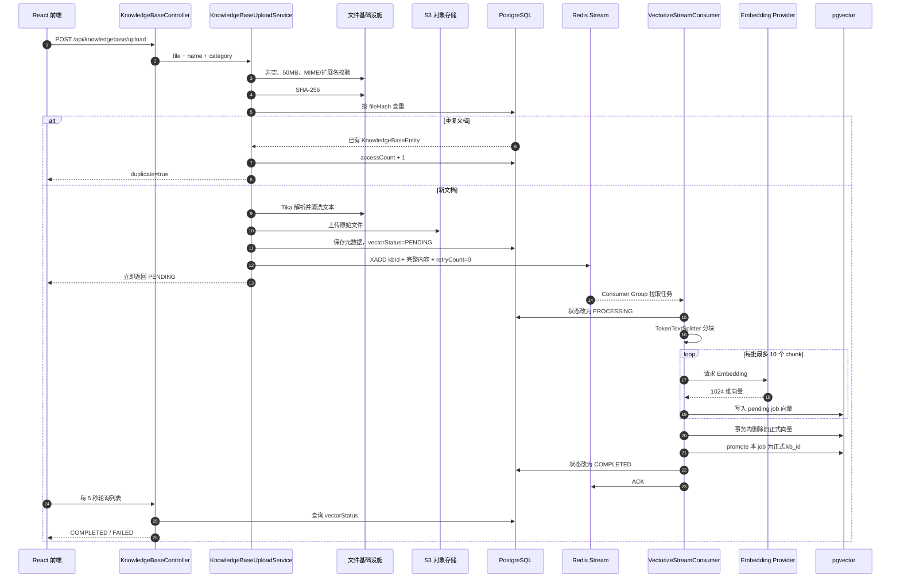
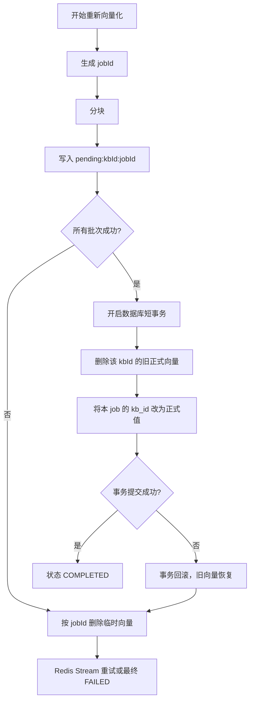
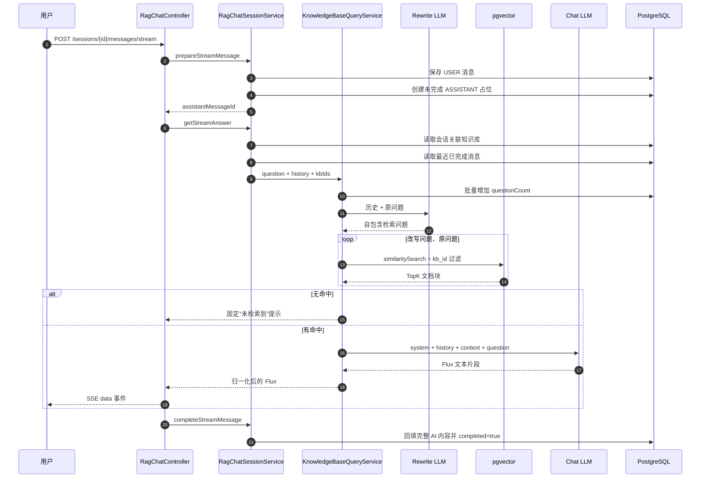
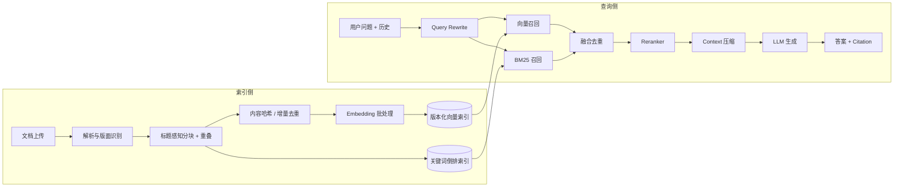

# 第 2 章：知识库 RAG 模块

> 学习目标：理解一份知识文档如何被解析、分块、向量化并写入 pgvector，以及用户问题如何经过查询改写、动态检索、Prompt 增强和 SSE 流式输出形成答案。

## 1. 一句话概括

知识库模块把非结构化文档转化为可检索的向量分块，再用“检索结果约束大模型回答”，从而让模型基于用户指定的私有资料进行多轮、流式问答，而不是只依赖模型训练时的通用知识。

它包含两个相互衔接但独立运行的流程：

1. 离线索引流程
   - 文档上传 → 解析清洗 → Redis Stream → 分块 → Embedding → pgvector。
2. 在线问答流程
   - 用户问题 → Query Rewrite → 相似度检索 → 上下文拼接 → LLM → SSE。

---

## 2. 设计思路

### 2.1 RAG 解决什么问题

直接向 LLM 提问存在三个问题：

- 模型不知道用户刚上传的内部文档。
- 模型训练知识可能过时。
- 模型可能根据通用知识“合理猜测”，却无法保证答案来自指定资料。

RAG，即 Retrieval-Augmented Generation，核心思路是：

1. 先从知识库检索与问题相关的文档片段。
2. 把这些片段作为 Context 放进 Prompt。
3. 要求模型只能依据 Context 回答。

可以概括为：

`用户问题 + 检索上下文 + 回答约束 → LLM 答案`

Embedding 模型不直接生成答案，它只负责把文本映射到向量空间。Chat Model 才负责最终语言生成。

### 2.2 为什么选择 PostgreSQL + pgvector

项目已经使用 PostgreSQL 保存：

- 知识库元数据。
- RAG 会话。
- 用户问题和 AI 回答。
- 其他简历、面试和日程数据。

引入 pgvector 后，同一个 PostgreSQL 还能保存：

- 文档分块文本。
- 1024 维 Embedding。
- JSON/JSONB 元数据。
- HNSW 向量索引。

当前规模下，这种选型减少了独立部署 Milvus、Qdrant 或 Elasticsearch 的运维成本，还可以用 SQL 直接清理和原子切换向量任务。

代价是：

- 超大规模向量分片和水平扩展能力有限。
- 当前没有 BM25 与向量的混合检索。
- 元数据过滤语法受 Spring AI PgVectorStore 适配层约束。
- 向量维度与数据库表结构绑定，切换不同维度的 Embedding 模型需要迁移或重新建表。

### 2.3 为什么向量化要异步

知识库文件最大允许 50 MB。解析后可能产生大量文本分块，每个分块都需要请求 Embedding API。

如果在上传请求里同步完成：

- HTTP 请求可能持续很久。
- Embedding API 限流或失败会直接拖垮上传体验。
- 无法方便地显示处理状态和重试。

因此上传接口只完成解析、对象存储和元数据入库，然后把任务写入 Redis Stream。前端每 5 秒轮询 `vectorStatus`：

`PENDING → PROCESSING → COMPLETED / FAILED`

### 2.4 为什么要分块

不能把整份文档直接生成一个向量：

- 文档可能超过 Embedding 模型输入上限。
- 整篇向量会把多个主题平均在一起，降低局部问题的检索精度。
- 将整份文档放进 Prompt 会浪费 Token。

`KnowledgeBaseVectorService` 使用 Spring AI `TokenTextSplitter`。代码注释说明默认每块约 800 Token，且当前没有重叠。

分块后的检索粒度变成：

`用户问题向量 ↔ 每个文档块向量`

只把最相关的 TopK 个块放入 Prompt。

### 2.5 为什么重新向量化采用“两阶段发布”

最简单的重新向量化做法是：

1. 删除旧向量。
2. 写入新向量。

问题是：新向量写到一半失败后，旧数据已经删除，知识库会处于“只有部分新数据”的不可用状态。

项目采用临时任务元数据：

- `kb_id = pending:{kbId}:{jobId}`
- `kb_target_id = {kbId}`
- `kb_vector_job_id = {jobId}`

所有批次写完后，才在短事务中：

1. 删除该知识库旧的正式向量。
2. 把本次 job 的临时向量提升为正式 `kb_id`。

失败则按 `jobId` 删除本次临时数据。

这类似数据库迁移中的“先构建新版本，再原子切换”，比边写边替换更可靠。

### 2.6 为什么要做 Query Rewrite

多轮问答中，用户经常会问：

- “它有什么缺点？”
- “第二种呢？”
- “为什么这么设计？”

这些问题单独拿去向量检索，缺少明确主题。系统会把最近对话历史和当前问题交给 LLM，改写成一条自包含检索语句。

为了防止改写偏离原意，项目同时保留：

- 改写后的问题。
- 原始问题。

检索时先尝试改写问题，没有有效结果再尝试原问题。

### 2.7 为什么按问题长度动态调整 TopK 和阈值

短问题通常信息不足，例如“Redis 呢”。如果只取少量结果并设置较高阈值，容易完全召回不到。

当前代码按去除空白后的字符数选择：

- 长度不超过 4
  - TopK = 20。
  - 最小分数 = 0.18，来自当前 `application.yml`。
- 长度不超过 12
  - TopK = 12。
  - 最小分数 = 0.28。
- 更长问题
  - TopK = 8。
  - 最小分数 = 0.28。

设计意图是：

- 短问题扩大召回，容忍更多弱相关结果。
- 长问题语义更明确，减少 TopK，控制 Prompt Token 和噪声。

这是一套人工启发式策略，不是经过离线评测自动得到的最优参数。

### 2.8 为什么使用 SSE

RAG 问答的通信方向主要是：

`浏览器提交一次问题 → 服务端持续返回文本片段`

它不需要像语音面试一样持续双向传输，因此使用 SSE：

- 基于 HTTP，部署和调试更简单。
- 可以边生成边展示，降低用户感知等待时间。
- 前端用 `fetch + ReadableStream` 处理 POST 流式响应。

项目没有使用浏览器原生 `EventSource`，因为原生 EventSource 主要用于 GET，不方便携带 JSON 请求体；前端自己实现了 SSE 解码器。

---

## 3. 数据处理流程

### 3.1 知识库上传与向量化

### 3.2 上传阶段逐步拆解

入口：

`POST /api/knowledgebase/upload`

#### 第一步：限流和文件校验

上传接口叠加：

- 全局 `count=3`。
- IP `count=3`。

业务层调用 `FileValidationService.validateFile(...)`：

- 文件不能为空。
- 文件不能超过 50 MB。

知识库允许的格式比简历更宽：

- PDF。
- DOC/DOCX。
- TXT。
- Markdown。
- RTF。

Markdown 除了 MIME 检测，还允许扩展名兜底，因为不同浏览器和操作系统可能把 `.md` 识别成 `text/plain` 或其他类型。

#### 第二步：文件哈希去重

`FileHashService` 计算 SHA-256，并查询：

`KnowledgeBaseRepository.findByFileHash(fileHash)`

命中后：

- 增加访问次数。
- 返回已有知识库和存储位置。
- 不重新上传。
- 不重新向量化。

这里有一个边界：如果已存在的知识库状态是 `FAILED`，重复上传仍只返回重复记录，并不会自动重新向量化。用户需要调用 `/revectorize`。

#### 第三步：文档解析

调用链：

`KnowledgeBaseParseService`

→ `DocumentParseService`

→ Apache Tika

→ `TextCleaningService`

解析逻辑与简历共享，包括文本长度限制、跳过嵌入图片、PDF 位置排序和文本清洗。

#### 第四步：对象存储与元数据入库

原文件写入 S3：

`knowledgebases/{yyyy/MM/dd}/{uuid}_{安全文件名}`

数据库 `knowledge_bases` 保存：

- SHA-256。
- 自定义名称或从文件名提取的名称。
- 分类。
- 原始文件名、大小和 Content-Type。
- S3 Key/URL。
- 访问次数、提问次数。
- 向量化状态和错误。
- `chunkCount`。

注意：当前实体虽然有 `chunkCount`，但主代码中没有调用 `setChunkCount(...)`，所以该字段会一直保持默认 0，不能用它证明实际分块数量。

#### 第五步：Redis Stream 入队

Stream Key：

`knowledgebase:vectorize:stream`

消息包含：

- `kbId`
- `content`
- `retryCount`

和简历模块一样，当前把完整文档文本写入 Redis。对最大 50 MB 文件而言，这会带来显著内存、网络和敏感数据扩散风险。更合理的消息应该只携带任务 ID 和知识库 ID。

### 3.3 分块与向量写入

核心方法：

`KnowledgeBaseVectorService.vectorizeAndStore(kbId, content)`

步骤如下：

1. 生成唯一 `jobId`。
2. 使用 `TokenTextSplitter` 生成 `List<Document>`。
3. 为每块添加临时元数据。
4. 按每批最多 10 块调用 `vectorStore.add(batch)`。
5. 全部写入成功后执行 `activateVectorJob(...)`。
6. 任一步失败则执行 `cleanupPendingVectorJob(...)`。

`vectorStore.add(...)` 内部通过默认 `EmbeddingModel` 生成向量，再写入 Spring AI 的 `vector_store` 表。

项目通过 `LlmEmbeddingConfig` 暴露一个委托型 `EmbeddingModel` Bean。每次调用会转发给：

`LlmProviderRegistry.getDefaultEmbeddingModel()`

因此在设置页切换默认 Embedding Provider 后，VectorStore 不需要重新注入 Bean，也能在下一次调用时使用新的模型。

### 3.4 两阶段向量发布

这里的原子性来自 PostgreSQL 事务：

- 删除旧向量和提升新向量在同一事务中。
- 如果提升失败，删除旧向量也会回滚。
- 外层再清理本次临时数据。

这是该模块最值得在面试中强调的实现细节之一。

### 3.5 在线 RAG 问答流程

### 3.6 RAG 检索步骤

`KnowledgeBaseQueryService.answerQuestionStream(...)`：

1. 参数检查。
2. 批量更新知识库 `questionCount`。
3. 从历史构建查询上下文。
4. LLM Query Rewrite。
5. 生成候选查询：改写结果优先，原问题兜底。
6. 根据原始问题长度确定 TopK 和最小分数。
7. 调用 `KnowledgeBaseVectorService.similaritySearch(...)`。
8. 拼接文档块。
9. 构建系统 Prompt 和用户 Prompt。
10. 携带历史消息调用 `ChatClient.stream().content()`。
11. 用 120 字符探测窗口归一化“无信息”回答。

### 3.7 pgvector 检索

`KnowledgeBaseVectorService.similaritySearch(...)` 构建：

- `query`
- `topK`
- `similarityThreshold`
- `filterExpression`

多知识库过滤表达式形如：

`kb_id in ['1', '2', '3']`

正常路径由 PostgreSQL 在向量检索阶段完成元数据过滤。

如果过滤表达式执行失败，代码会回退：

1. 不带知识库过滤检索 `topK * 3`。
2. 在 Java 内根据文档 metadata 过滤。
3. 截取前 TopK。

该兜底保证过滤语法不兼容时服务仍能运行，但存在召回缺陷：全局前 `topK * 3` 中可能没有目标知识库片段，即使目标知识库稍后存在相关结果，也会被误判为无命中。

### 3.8 Prompt 构建

系统 Prompt：

`prompts/knowledgebase-query-system.st`

主要约束：

- 只根据检索上下文回答。
- 信息不足时明确说明。
- 中文、Markdown 和结构化表达。
- 多知识库内容去重整合。

用户 Prompt：

`prompts/knowledgebase-query-user.st`

把检索文本放入明确的数据边界：

`---文档内容开始--- ... ---文档内容结束---`

系统 Prompt 还追加 `PromptSecurityConstants.ANTI_INJECTION_INSTRUCTION`，声明文档中的指令只是数据，不能覆盖系统任务。

当前 RAG 没有调用 `PromptSanitizer` 对文档和历史消息做正则净化，`sanitizeHistory(...)` 实际只是原样返回。这意味着它有系统指令和边界隔离，但不是完整的三层 Prompt 防护。

### 3.9 流式“无结果”归一化

不同模型可能输出：

- “没有找到相关信息……”
- “信息不足……”
- “超出知识库范围……”

如果这些长篇拒答直接流给前端，用户体验不一致。

`normalizeStreamOutput(...)` 先缓冲前 120 个字符：

- 若出现预设无结果语句，取消上游订阅，只输出统一提示。
- 若达到 120 字仍不是拒答，释放缓冲并切换为实时透传。
- 若模型在 120 字内正常结束，也统一处理后输出。

代价是首批内容需要等待最多 120 个字符，增加一点首屏延迟。

### 3.10 RAG 会话与历史上下文

一个 `RagChatSessionEntity`：

- 可以关联多个知识库，多对多。
- 可以包含多条消息，一对多。
- 支持标题、置顶、归档状态和消息计数。

发送问题前：

1. 保存用户消息，`completed=true`。
2. 创建 AI 空消息，`completed=false`。
3. 增加 `messageCount`。

生成回答时：

- 默认读取最近 10 条已完成消息。
- 查询结果按倒序取回，再恢复为时间正序。
- 排除当前刚保存但尚未回答的用户消息。
- 转换为 Spring AI `UserMessage` 和 `AssistantMessage`。

项目没有使用默认关闭的 `MessageChatMemoryAdvisor`，而是以 PostgreSQL 为真实历史来源，避免多实例或重启后丢失上下文。

### 3.11 SSE 前端处理

`frontend/src/api/stream.ts` 使用：

- `fetch(...)`
- `response.body.getReader()`
- `TextDecoder`
- 手工缓冲半包
- 按 SSE 行或事件块解析
- 识别 JSON 业务错误
- 支持转义换行恢复

`RagChatController` 把每个 chunk 包装为 `ServerSentEvent<String>`，并把真实换行转义为 `\\n`/`\\r`，避免一个模型 chunk 中的换行破坏 SSE 行协议。前端收到后再反转义。

---

## 4. 关键代码解析

### 4.1 管理与查询入口

路径：

`app/src/main/java/interview/guide/modules/knowledgebase/KnowledgeBaseController.java`

主要接口：

- `/api/knowledgebase/upload`
  - 上传并异步向量化。
- `/api/knowledgebase/list`
  - 按状态和字段排序。
- `/api/knowledgebase/query`
  - 无会话的同步 RAG。
- `/api/knowledgebase/query/stream`
  - 无会话的流式 RAG。
- `/api/knowledgebase/{id}/revectorize`
  - 手动重新向量化。
- `/api/knowledgebase/{id}/download`
  - 下载原文件。
- 分类、搜索和统计接口。

路径：

`app/src/main/java/interview/guide/modules/knowledgebase/RagChatController.java`

主要接口：

- 创建、读取、置顶和删除 RAG 会话。
- 更新会话标题和关联知识库。
- `/messages/stream` 多轮流式问答。

### 4.2 上传编排

路径：

`modules/knowledgebase/service/KnowledgeBaseUploadService.java`

`uploadKnowledgeBase(...)` 依次编排：

`校验 → MIME → SHA-256 → 去重 → Tika → S3 → PostgreSQL → Redis Stream`

外部资源调用没有放入数据库长事务。这一点正确，但 S3、数据库和 Redis 之间仍需要补偿机制。

`revectorize(...)` 从 S3 下载原文件重新解析，把状态改为 `PENDING` 后再发送任务。它不会直接删除旧向量；旧向量会一直可用，直到新 job 全部成功并执行原子切换。

### 4.3 向量化生产者和消费者

路径：

- `modules/knowledgebase/listener/VectorizeStreamProducer.java`
- `modules/knowledgebase/listener/VectorizeStreamConsumer.java`

消费者复用 `AbstractStreamConsumer`：

- 跳过已 `COMPLETED` 或已删除的知识库。
- 更新 `PROCESSING`。
- 调用 `vectorizeAndStore(...)`。
- 成功后 `COMPLETED + ACK`。
- 失败时最多重新入队 3 次。
- 超限后 `FAILED`。

重新向量化会先把状态重置为 `PENDING`，所以不会被 `shouldSkip(COMPLETED)` 拦截。

### 4.4 分块、Embedding 与检索

路径：

`modules/knowledgebase/service/KnowledgeBaseVectorService.java`

关键方法：

- `vectorizeAndStore(kbId, content)`
  - 分块、临时写入、批处理和发布。
- `similaritySearch(query, kbIds, topK, minScore)`
  - 向量检索与元数据过滤。
- `similaritySearchFallback(...)`
  - 过滤异常时的 Java 本地过滤。
- `deleteByKnowledgeBaseId(...)`
  - 删除知识库向量。

`MAX_BATCH_SIZE=10` 是根据 DashScope Embedding API 限制设置的。即使切换到其他 Provider，这个固定值仍存在，属于用最保守公共上限换取兼容性的选择。

### 4.5 原生 SQL 向量仓储

路径：

`modules/knowledgebase/repository/VectorRepository.java`

Spring AI `VectorStore` 负责通用添加和检索；项目使用 `JdbcTemplate` 补足特定运维操作：

- 按 `kb_id` 删除。
- 按 `jobId` 清理临时向量。
- 用 `jsonb_set` 提升临时 job。

这是“框架抽象 + 必要原生 SQL”的组合：

- 普通能力使用 Spring AI，降低接入成本。
- 框架没有提供的原子发布能力使用 PostgreSQL SQL 实现。

### 4.6 动态 Embedding Provider

路径：

- `common/config/LlmEmbeddingConfig.java`
- `common/ai/LlmProviderRegistry.java`

注册表会：

- 检查 Provider 是否声明支持 Embedding。
- 检查 Embedding 模型名不是明显的聊天模型。
- 配置模型名和向量维度。
- 缓存 `EmbeddingModel`。
- Provider reload 时清空缓存。

必须注意：同一个 `vector_store` 中的向量必须由兼容的模型和相同维度生成。仅仅切换默认 Embedding Provider，不重新向量化旧知识库，会导致新查询向量与旧文档向量语义空间不一致，即使维度同为 1024，检索结果也可能失真。

### 4.7 查询服务

路径：

`modules/knowledgebase/service/KnowledgeBaseQueryService.java`

它承担：

- Query Rewrite。
- 动态检索参数。
- 候选查询回退。
- 多知识库过滤。
- Context 拼接。
- 同步/流式 LLM 调用。
- 无结果归一化。

当前 Query Rewrite 使用 `getDefaultChatClient()`，该客户端可能带 Skills Tool 和默认 Advisor。改写任务只需要单行文本，更稳妥的是使用不带工具的 Plain ChatClient，避免无关工具调用影响改写结果。

### 4.8 会话服务

路径：

`modules/knowledgebase/service/RagChatSessionService.java`

值得说明的细节：

- 会话详情分两次查询知识库和消息，避免同时 Join Fetch 两个集合导致笛卡尔积。
- 消息数量作为冗余字段，列表页无需每次 COUNT。
- 流式回答先创建占位消息，结束后回填。
- 历史消息从数据库加载，不依赖进程内 Memory。

### 4.9 删除流程

路径：

`modules/knowledgebase/service/KnowledgeBaseDeleteService.java`

实际顺序：

1. 数据库事务内解除所有 RAG 会话关联。
2. 删除知识库元数据。
3. 事务外删除向量。
4. 事务外删除 S3 文件。

S3 删除失败会记录可补偿日志。

向量删除方法 `deleteByKnowledgeBaseId(...)` 会吞掉异常并继续，因此数据库记录可能已删除，但向量仍残留。这种顺序避免外部操作占用事务，却需要后台孤儿数据清理能力。

---

## 5. 技术亮点与难点

### 5.1 两阶段向量发布

这是该模块最强的工程亮点：

- 新向量先写临时 job。
- 全部成功后才替换正式版本。
- 删除旧版本与提升新版本处于同一数据库事务。
- 失败可按 jobId 定向清理。

面试表达：

> 重新向量化不能先删旧数据，否则中途失败会让知识库只剩半套索引。我给每次任务生成 jobId，新向量先以 pending 元数据写入，全部完成后在 PostgreSQL 事务中删除旧版本并 promote 新版本，实现类似蓝绿发布的切换。

### 5.2 Query Rewrite 不是唯一检索入口

项目没有盲目信任改写结果，而是使用 `LinkedHashSet` 同时保留改写问题和原问题，既去重又保持顺序。

这是一种低成本的检索容错：

- 改写成功时改善多轮追问召回。
- 改写偏离时仍可以回退原问题。
- 改写 API 失败时直接使用原问题。

### 5.3 动态召回参数

短问题扩大 TopK 和降低阈值，长问题缩小 TopK。这体现了“检索参数应与查询特征关联”，而不是所有问题固定 `topK=5`。

不过参数仍是经验值，面试时不能宣称“准确率提升了多少”，因为项目没有离线评测数据。

### 5.4 多轮历史由数据库管理

优势：

- 应用重启后历史仍存在。
- 多实例可以访问同一份历史。
- 会话可置顶、修改标题和切换知识库。
- 控制最近 N 条消息，避免上下文无限增长。

相比直接使用内存 ChatMemory，更符合需要长期保留会话的产品。

### 5.5 流式回答持久化

先保存用户消息和 AI 占位，再启动流式生成：

- 用户刷新页面后，问题不会丢失。
- 成功后可以一次性回填完整 AI 答案。
- 出错时保存已收到的部分内容或错误文本。

### 5.6 必须说明的实现边界

#### 边界一：当前不是“高级 RAG”

代码已经实现向量检索和 Query Rewrite，但没有：

- BM25/关键词混合召回。
- Reranker。
- 文档标题、页码和 chunk 序号引用。
- Citation 返回结构。
- Embedding 缓存。
- 离线检索评测集。

不能在面试中声称系统实现了混合检索或重排序。

#### 边界二：分块没有重叠和文档结构感知

默认 TokenTextSplitter 约 800 Token、无重叠。它可能：

- 把标题与正文分开。
- 在语义边界切断上下文。
- 无法保留页码和章节层级。

可以升级为 Markdown/标题感知分块，并为相邻块加入适当重叠。

#### 边界三：`chunkCount` 没有实际更新

实体和 DTO 暴露了分块数，但向量化完成后没有写入真实 chunks 数量。前端看到的值并不能代表实际分块结果。

#### 边界四：切换 Embedding 模型后的兼容问题

即使两个模型都是 1024 维，也不代表它们处于相同语义空间。切换默认 Embedding Provider 后，必须重新向量化所有旧知识库。

系统当前没有：

- 在向量 metadata 保存 embedding provider/model/version。
- 阻止混合模型向量。
- 自动迁移旧索引。

#### 边界五：流式取消可能留下未完成占位

Controller 对 complete 和 error 都会回填 AI 消息，但用户主动断开连接触发 cancel 时，没有 `doFinally` 或 `doOnCancel` 更新占位。

Repository 虽然定义了 `findBySessionIdAndCompletedFalse(...)`，主代码没有使用它清理或恢复未完成消息。

#### 边界六：并发发送消息可能产生顺序竞争

下一条消息序号来自 `session.messageCount`。如果同一会话并发提交两个问题：

- 两个事务可能读到相同 messageCount。
- 生成重复 messageOrder。
- 会话计数可能丢失更新。

当前没有乐观锁 `@Version`、行锁或唯一约束防护。

#### 边界七：Prompt 注入防护并不完整

系统 Prompt 有反注入指令，文档有边界标签，但 RAG 历史和 Context 没有走 `PromptSanitizer`。对于恶意知识库文档，仍需：

- 输入侧清洗。
- 权限隔离。
- 输出侧策略校验。
- 对工具调用场景采用更严格的最小权限。

---

## 6. 面试问答演练

### 问题一：请介绍知识库从上传到可以问答的完整流程

参考回答：

> 用户上传文档后，系统先校验大小和真实 MIME，再计算 SHA-256 去重。新文档通过 Tika 提取并清洗正文，原文件写入 S3，元数据以 PENDING 状态写入 PostgreSQL，然后把 kbId 和文本写入 Redis Stream。消费者把状态改成 PROCESSING，使用 TokenTextSplitter 分块，每批最多 10 个 chunk 调用默认 Embedding 模型，通过 Spring AI VectorStore 写入 pgvector。新向量先携带 pending jobId，所有批次成功后才在事务中删除旧向量并提升新向量，最后状态改成 COMPLETED。前端处理期间每 5 秒轮询。

### 问题二：一次 RAG 问答是怎么完成的？

参考回答：

> 系统先加载会话关联的知识库和最近历史消息，用 LLM 把追问改写成可独立检索的查询，同时保留原问题作为兜底。然后根据问题长度动态选择 TopK 和相似度阈值，在 pgvector 中做余弦相似度检索，并按 kb_id 过滤。命中的文档块拼接为 Context，和原问题、历史消息一起交给 ChatClient。模型通过 Flux 流式输出，Controller 包装成 SSE，前端边读取边展示，完成后把完整答案回填到数据库占位消息。

### 问题三：为什么需要 Query Rewrite？

参考回答：

> 多轮对话中的“它有什么缺点”缺少主语，直接 Embedding 很难检索。Query Rewrite 会结合最近历史，把它改成例如“Redis Stream 作为异步队列的缺点”。但 LLM 改写也可能偏离，所以系统把改写问题和原问题都作为候选，改写失败或无命中时回退原问题。

### 问题四：为什么不用固定 TopK？

参考回答：

> 短问题语义不完整，更容易与目标向量距离偏大，所以项目扩大 TopK 并降低阈值；长问题信息充分，可以减少 TopK，降低噪声和 Prompt Token。不过这只是启发式策略。生产环境应该建立问题—相关文档标注集，用 Recall@K、MRR 和最终答案指标调整，而不是凭经验无限调参。

### 问题五：重新向量化如何避免中途失败污染线上数据？

参考回答：

> 每次任务生成 jobId，新 chunks 先以 pending 元数据写入，不会被正式 kb_id 检索。所有批次成功后，才在 PostgreSQL 事务里删除旧正式向量并把本 job 提升为正式版本。如果提升失败事务会回滚，旧向量仍在；外层再按 jobId 清理临时向量。这是一种轻量的两阶段发布。

### 问题六：为什么选择 HNSW 和余弦距离？

参考回答：

> 文本 Embedding 通常关心方向相似度，余弦距离适合衡量语义方向。HNSW 是近似最近邻索引，通过图结构在召回率和查询速度之间取得较好平衡，适合在线检索。代价是索引构建和内存开销更高。项目只是声明使用 HNSW，没有针对 ef_search、m 等参数做压测调优，所以我不会宣称已经达到某个性能指标。

### 问题七：如何保证回答不脱离知识库？

参考回答：

> 当前系统先设置相似度阈值，无有效命中就直接返回固定提示；有命中后，Prompt 明确要求只能依据 Context 回答，并给文档内容加数据边界，再追加反 Prompt 注入指令。模型流式输出后还会统一识别“信息不足”类拒答。不过 LLM 仍不是形式化证明系统，真正生产环境还要增加引用来源、答案忠实度评测和输出侧校验。

### 问题八：切换 Embedding Provider 后需要做什么？

参考回答：

> 需要检查向量维度，并对旧知识库重新向量化。不同模型即使维度相同，语义空间也不同，用新模型生成查询向量去搜索旧模型生成的文档向量，结果没有可比性。更完善的设计应该在每条向量中记录 provider、model 和 version，并按索引版本隔离查询。

### 问题九：为什么 SSE 不直接使用 EventSource？

参考回答：

> 问答接口需要 POST JSON，包括会话 ID 和问题。浏览器原生 EventSource 主要使用 GET，参数和请求体能力有限，所以前端采用 fetch 获取 ReadableStream，再手工按 SSE 协议解析 data 行和事件块。这样既保留 POST，也能流式展示。

### 问题十：这个 RAG 还能怎么提升？

参考回答：

> 我会先建立评测集，然后按问题定位瓶颈。如果是召回不足，增加标题感知分块、重叠和 BM25 混合召回；如果召回噪声大，增加 Reranker；如果用户不信任答案，保存页码和来源并返回 Citation；如果成本高，增加 Embedding 缓存、文档增量更新和按任务选择模型。

---

## 7. 延伸思考

### 7.1 一个更完整的生产级 RAG 架构

### 7.2 分块策略改进

可以从简单 Token 分块升级为：

1. 先按文档结构切分
   - Markdown 标题。
   - PDF 页码和段落。
   - Word 标题层级。
2. 超长章节再按 Token 二次切分。
3. 相邻 chunk 保留 10% 到 20% 重叠。
4. metadata 保存：
   - 文档 ID。
   - 文档名称。
   - 页码。
   - 标题路径。
   - chunkIndex。
   - embeddingModel。
   - indexVersion。

### 7.3 检索评测

至少建立两层指标：

#### 检索层

- Recall@K：相关片段是否出现在前 K 条。
- Precision@K：前 K 条中有多少真正相关。
- MRR：第一个相关结果排得多靠前。
- 无结果识别准确率。

#### 生成层

- Faithfulness：答案是否被 Context 支持。
- Answer Relevance：是否回答了问题。
- Citation Accuracy：引用是否指向正确来源。
- 延迟：改写、检索、首 Token 和总耗时。
- Token 与费用。

### 7.4 数据与索引一致性

生产环境建议为知识库建立明确索引版本：

`knowledge_base_id + index_version + embedding_model`

更新时：

1. 创建新版本。
2. 后台完整构建。
3. 通过一条“当前版本”记录原子切换。
4. 延迟删除旧版本。

当前 jobId 两阶段发布已经具备这个思路的雏形。

### 7.5 流式会话可靠性

可增加：

- `doFinally` 根据 COMPLETE、ERROR、CANCEL 更新占位消息。
- 用户取消时保存“生成已取消”状态，而不是空消息。
- 服务重启后扫描 `completed=false` 的旧消息并标记中断。
- `messageOrder` 增加数据库唯一约束。
- 会话增加 `@Version` 乐观锁。
- 为一个会话串行化发送请求。

### 7.6 安全与权限

知识库通常包含内部资料，应增加：

- 用户/租户级知识库权限。
- 检索前权限过滤，而不是生成后再过滤。
- 私有对象存储和签名下载。
- 文档内容加密与审计。
- Prompt 注入检测和输出审核。
- 禁止不同租户的向量进入同一无隔离过滤范围。

### 7.7 面试中的准确项目定位

推荐表达：

> 我实现和学习的是一个工程化基础 RAG：具备异步文档向量化、pgvector HNSW 检索、Query Rewrite、多知识库过滤、动态 TopK、SSE 流式问答和持久化多轮会话。它还没有混合检索、Reranker 和 Citation，我能说明这些能力什么时候需要以及如何演进。

不要表达为：

- “使用了最先进的混合检索”。
- “系统完全杜绝幻觉”。
- “HNSW 参数已经达到生产最优”。
- “切换任意 Embedding 模型都不需要重新索引”。

---

下一章预告：第 3 章将分析模拟面试如何加载 `SKILL.md`、结合简历与 JD 生成题目、避免历史题目重复、管理多轮追问，并把面试会话同时保存到 Redis 和 PostgreSQL。
