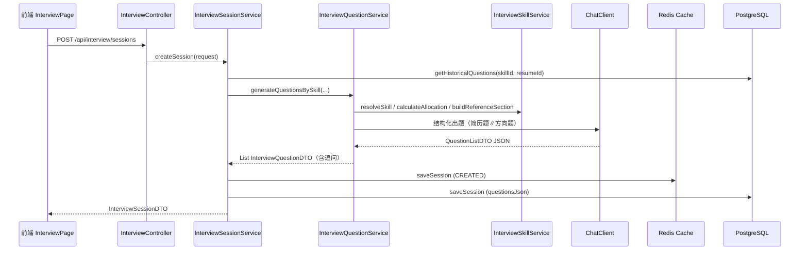
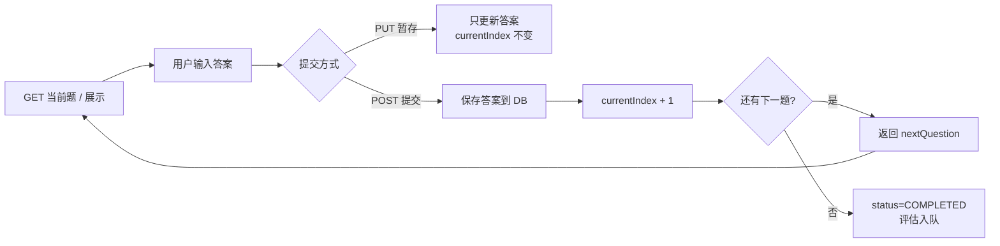
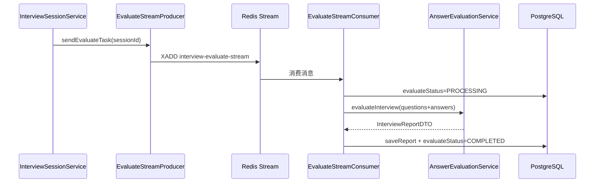

# 第 3 章：模拟面试模块

> 学习目标：理解文字模拟面试如何从 Skill 配置驱动出题、结合简历与 JD 生成题目、避免历史重复、管理多轮追问，以及会话状态如何在 Redis 与 PostgreSQL 之间协同，并通过 Redis Stream 异步触发评估。

## 1. 一句话概括

模拟面试模块把「面试方向 Skill + 可选简历/JD + 历史去重」转化为一套可恢复的问答会话：创建会话时同步调用 LLM 生成题目并写入 Redis/PostgreSQL，用户逐题作答后由 Redis Stream 异步触发统一评估引擎生成报告。

与简历分析不同，**出题发生在创建会话的同步请求内**（前端超时设为 180 秒）；**评估**才是异步的，通过 `EvaluateStreamProducer` 入队、`EvaluateStreamConsumer` 消费。

---

## 2. 设计思路

### 2.1 为什么用 Skill 驱动出题，而不是写死 Prompt

如果把「Java 后端面试题」写死在代码里，每新增一个方向就要改 Java 代码、重新部署。项目采用 **classpath 资源即配置** 的方式：

| 文件 | 作用 |
|------|------|
| `skills/{skillId}/SKILL.md` | 面试官 Persona（角色、风格、出题约束） |
| `skills/{skillId}/skill.meta.yml` | 分类、优先级、参考文件绑定、前端展示信息 |
| `skills/_shared/references/*.md` | 跨 Skill 共享的知识点参考 |

启动时 `InterviewSkillService.loadPresetSkills()` 扫描 `classpath:skills/*/SKILL.md`，解析 YAML front matter 和 `skill.meta.yml`，注册到内存 `presetRegistry`。当前代码中共有 **10 个预设 Skill**（`ai-agent-dev`、`algorithm`、`ali-backend`、`bytedance-backend`、`frontend`、`java-backend`、`java-backend-tencent`、`python-backend`、`system-design`、`test-development`），不是 README 中常见的「10+」模糊表述。

出题时后端做三件事：

1. 按 `priority`（`ALWAYS_ONE` / `CORE` / `NORMAL`）把 `questionCount` 分配到各分类。
2. 把对应 `references/*.md` 注入 Prompt，给 LLM 提供出题基线。
3. 把 `SKILL.md` body 作为 Persona 追加到 system prompt。

这样新增面试方向只需加资源文件，不必改核心业务代码。

### 2.2 为什么有简历时要「60% 简历题 + 40% 方向题」并行生成

纯 Skill 出题适合通用考察，但无法深挖候选人真实项目。纯简历出题又可能忽略该方向的系统性知识点。

`InterviewQuestionService` 在检测到 `resumeText` 非空时：

```
resumeCount = round(questionCount × 0.6)   // 至少 1 题
directionCount = questionCount - resumeCount
```

两路调用通过 `Executors.newVirtualThreadPerTaskExecutor()` **并行**执行：

- **简历题**：`resumeSystemPrompt` + 简历全文 + 历史去重段 + Skill Persona。
- **方向题**：`skillSystemPrompt` + 分类分配表 + references + JD 段 + 历史去重段。

任一路失败有降级策略：

- 简历题失败 → 取消方向题 Future，退回全方向题。
- 方向题失败 → 若简历题非空则只返回简历题，否则走 `generateFallbackQuestions`。
- 两路都空 → 硬编码兜底题。

无简历时走 `generateDirectionOnly`，并在 system prompt 追加 `GENERIC_MODE_SYSTEM_APPEND`，禁止出现「你在简历中提到…」这类表述。

### 2.3 为什么主问题与追问要拍平成一条列表

`InterviewQuestionDTO` 用 `isFollowUp` 和 `parentQuestionIndex` 区分主问题与追问，全部放在一个有序列表里。前端按 `currentQuestionIndex` 线性推进，不需要单独的「追问状态机」。

追问数量由配置 `app.interview.follow-up-count` 控制，默认 **1**，代码硬上限 **2**（`MAX_FOLLOW_UP_COUNT`）。AI 返回的 `followUps` 会经 `sanitizeFollowUps` 截断；兜底题也会按 `followUpCount` 生成默认追问文案。

### 2.4 为什么要历史题目去重

同一候选人、同一 `skillId` 多次面试时，若不做约束，LLM 容易重复考同一知识点。`InterviewPersistenceService.getHistoricalQuestions` 会：

1. 查最近 **10** 个历史会话（有 `resumeId` 时按 `resumeId + skillId`，无简历时只按 `skillId`）。
2. 从 `questionsJson` 解析题目，**过滤掉追问**，保留 `question`、`type`、`topicSummary`。
3. 按 `question` 文本去重，最多保留 **60** 道。
4. 压缩成按分类分组的 `topicSummary` 列表，注入 Prompt 的 `historicalSection`。

这样传给 LLM 的是「已考过的知识点摘要」，而不是完整题干，节省 Token 同时保留去重语义。

### 2.5 为什么 Redis + PostgreSQL 双写会话

面试进行中需要高频读写当前题号、答案、状态。全部打 PostgreSQL 会增加延迟；只放 Redis 又有丢失风险。

项目策略：

- **Redis**（`InterviewSessionCache`）：热数据，`interview:session:{sessionId}`，TTL **24 小时**；`resumeId` 未完成会话映射 `interview:resume:{resumeId}`。
- **PostgreSQL**：冷备与历史，`interview_sessions` + `interview_answers`；缓存 miss 时从 DB 恢复并回写 Redis。

读取路径：**Redis 优先 → DB 恢复 → 回写 Redis**。每次 `getOrRestoreSession` 会 `refreshSessionTTL`。

注意：创建会话时 DB 写入失败只 `log.warn`，不阻断返回（与简历模块类似，存在 Redis 有、DB 无的短暂不一致）。

### 2.6 为什么评估要异步，而出题要同步

- **出题**：用户点击「开始面试」后必须立刻看到第一道题；且题目列表要在会话创建时确定，便于历史去重和进度恢复。因此 `POST /api/interview/sessions` 同步等待 LLM，前端 `timeout: 180000`。
- **评估**：答完所有题或提前交卷后，用户可以先离开；评估可能调用多次 LLM、耗时更长。因此走 Redis Stream：`PENDING → PROCESSING → COMPLETED / FAILED`。

另外还存在同步评估入口 `GET /api/interview/sessions/{id}/report`（`generateReport`），用于用户主动拉报告；与 Stream 异步评估是**两条路径**，第 4 章会展开评估引擎细节。

### 2.7 关于「阶段时长联动」的澄清

README 或产品描述中的「面试阶段时长联动」**属于语音面试模块**（`VoiceInterviewService.startPhase`、`plannedDuration`、INTRO/TECH/PROJECT/HR 四阶段），不是本章文字模拟面试。

文字面试的配置维度是：

- `questionCount`：3–20（前端快捷选项 6/8/10/12）。
- `difficulty`：`junior` / `mid` / `senior`。
- `skillId` 或自定义 JD 解析分类。

`useInterviewConfig` 中的 `plannedDuration` 仅在 `mode === 'voice'` 时展示滑块，文字模式不传后端。

---

## 3. 数据处理流程

### 3.1 创建会话（同步出题）



**步骤说明：**

1. 若 `resumeId` 存在且 `forceCreate != true`，先查未完成会话，有则直接返回（恢复进度）。
2. 生成 16 位 `sessionId`（UUID 去横线截断）。
3. 加载历史题目 → Skill 驱动 LLM 出题 → 合并/截断主问题数。
4. Redis 缓存完整题目列表；DB 持久化 `questionsJson`、`skillId`、`difficulty`、`llmProvider`。
5. 返回会话，前端 `initSession` 展示第一题。

### 3.2 答题循环



- 首次 `getCurrentQuestion` 会把状态从 `CREATED` 改为 `IN_PROGRESS`（Redis + DB）。
- `submitAnswer`：**先写 DB**（失败则抛 `INTERVIEW_ANSWER_SAVE_FAILED`），再更新 Redis。
- 最后一题提交或 `POST .../complete` 提前交卷 → `evaluateStatus=PENDING` → `EvaluateStreamProducer.sendEvaluateTask`。

### 3.3 异步评估



消费者 `shouldSkip`：若 `evaluateStatus == COMPLETED` 则跳过，避免重复评估。失败时 `retryMessage` 重新入队。

### 3.4 自定义面试（JD 解析）流程

1. 前端 `InterviewHubPage` 选择「自定义」，输入 JD（至少 50 字）。
2. `POST /api/skills/parse-jd` → `InterviewSkillService.parseJd`：LLM 结构化输出分类列表，并匹配 `categoryRefIndex` 纠正 `ref/shared`。
3. 创建会话时 `skillId=custom`，传入 `customCategories` + `jdText`。
4. `buildCustomSkill` 构建临时 `SkillDTO`，`sourceJd` 注入方向题 Prompt 的 `jdSection`。

---

## 4. 关键代码解析

### 4.1 会话创建与双写

```55:115:interview-guide-study/app/src/main/java/interview/guide/modules/interview/service/InterviewSessionService.java
    public InterviewSessionDTO createSession(CreateInterviewRequest request) {
        // 如果指定了resumeId且未强制创建，检查是否有未完成的会话
        if (request.resumeId() != null && !Boolean.TRUE.equals(request.forceCreate())) {
            Optional<InterviewSessionDTO> unfinishedOpt = findUnfinishedSession(request.resumeId());
            if (unfinishedOpt.isPresent()) {
                return unfinishedOpt.get();
            }
        }
        // ...
        List<HistoricalQuestion> historicalQuestions =
            persistenceService.getHistoricalQuestions(skillId, request.resumeId());

        List<InterviewQuestionDTO> questions = questionService.generateQuestionsBySkill(
            request.llmProvider(), skillId, difficulty,
            request.resumeText(), request.questionCount(),
            historicalQuestions, request.customCategories(), request.jdText()
        );

        sessionCache.saveSession(sessionId, ..., questions, 0, SessionStatus.CREATED);
        try {
            persistenceService.saveSession(sessionId, request.resumeId(), ...);
        } catch (Exception e) {
            log.warn("保存面试会话到数据库失败: {}", e.getMessage());
        }
        return new InterviewSessionDTO(...);
    }
```

面试表达要点：未完成会话恢复是**产品功能**而非 bug；`forceCreate: true` 是前端 `InterviewPage` 新建时显式传入的。

### 4.2 并行出题与比例分配

```130:188:interview-guide-study/app/src/main/java/interview/guide/modules/interview/service/InterviewQuestionService.java
        boolean hasResume = resumeText != null && !resumeText.isBlank();
        if (!hasResume) {
            return generateDirectionOnly(...);
        }

        int resumeCount = Math.max(1, (int) Math.round(questionCount * RESUME_QUESTION_RATIO));
        int directionCount = questionCount - resumeCount;

        CompletableFuture<List<InterviewQuestionDTO>> resumeFuture = CompletableFuture.supplyAsync(
            () -> generateResumeQuestions(...), questionExecutor);
        CompletableFuture<List<InterviewQuestionDTO>> directionFuture = CompletableFuture.supplyAsync(
            () -> generateDirectionOnly(...), questionExecutor);
        // 失败降级 + mergeQuestionBatches 合并（追问索引 offset）
```

`mergeQuestionBatches` 会给第二批题目的 `questionIndex` 和 `parentQuestionIndex` 加上 offset，保证全局索引连续。

### 4.3 分类题量分配算法

```252:314:interview-guide-study/app/src/main/java/interview/guide/modules/interview/skill/InterviewSkillService.java
    public Map<String, Integer> calculateAllocation(List<SkillCategoryDTO> categories, int totalQuestions) {
        // Phase 1: ALWAYS_ONE 保底各 1 题
        // Phase 2: CORE 优先、再 NORMAL，各类目先各 1 题
        // Phase 3: 剩余名额 CORE 优先轮转
```

以 `java-backend` 为例：`PROJECT` 为 `ALWAYS_ONE`，`JAVA/MYSQL/REDIS` 为 `CORE`。若 `questionCount=6`，典型分配会保证项目题至少 1 道，核心分类优先覆盖，再轮转填充。

### 4.4 历史去重压缩

```404:427:interview-guide-study/app/src/main/java/interview/guide/modules/interview/service/InterviewQuestionService.java
    private String buildHistoricalSection(List<HistoricalQuestion> historicalQuestions) {
        // 按 type 分组，优先用 topicSummary，否则截断 question 前 30 字
        StringBuilder sb = new StringBuilder("已考过的知识点（避免重复出题）：\n");
        for (Map.Entry<String, List<String>> entry : grouped.entrySet()) {
            sb.append("- ").append(entry.getKey()).append(": ");
            sb.append(String.join(", ", entry.getValue()));
        }
        return sb.toString();
    }
```

依赖 LLM 在出题时输出 `topicSummary`；若 AI 未填，退化为题干截断，去重粒度变粗。

### 4.5 提交答案与评估入队

```292:364:interview-guide-study/app/src/main/java/interview/guide/modules/interview/service/InterviewSessionService.java
    public SubmitAnswerResponse submitAnswer(SubmitAnswerRequest request) {
        // ...
        persistSubmittedAnswer(...);  // DB 先成功
        sessionCache.updateQuestions(...);
        sessionCache.updateCurrentIndex(...);
        if (newStatus == SessionStatus.COMPLETED) {
            sessionCache.updateSessionStatus(..., COMPLETED);
            enqueueEvaluationTask(request.sessionId());
        }
        return new SubmitAnswerResponse(hasNextQuestion, nextQuestion, newIndex, questions.size());
    }

    private void enqueueEvaluationTask(String sessionId) {
        persistenceService.updateEvaluateStatus(sessionId, AsyncTaskStatus.PENDING, null);
        evaluateStreamProducer.sendEvaluateTask(sessionId);
    }
```

### 4.6 Redis 缓存结构

```35:45:interview-guide-study/app/src/main/java/interview/guide/infrastructure/redis/InterviewSessionCache.java
    private static final String SESSION_KEY_PREFIX = "interview:session:";
    private static final String RESUME_SESSION_KEY_PREFIX = "interview:resume:";
    private static final Duration SESSION_TTL = Duration.ofHours(24);
```

`CachedSession` 把 `List<InterviewQuestionDTO>` 序列化为 `questionsJson` 字符串存 Redis；状态变为 `COMPLETED` 后会移除 `resumeId → sessionId` 映射。

### 4.7 问题 DTO 结构

```7:18:interview-guide-study/app/src/main/java/interview/guide/modules/interview/model/InterviewQuestionDTO.java
public record InterviewQuestionDTO(
    int questionIndex,
    String question,
    String type,           // Skill category key，如 MYSQL
    String category,       // 展示标签，如 MySQL
    String topicSummary,   // 知识点摘要，用于历史去重
    String userAnswer,
    Integer score,
    String feedback,
    boolean isFollowUp,
    Integer parentQuestionIndex
)
```

`type` 不再用枚举，由 Skill 的 `category.key` 驱动，方便自定义 JD 分类扩展。

### 4.8 API 一览

| 方法 | 路径 | 说明 |
|------|------|------|
| POST | `/api/interview/sessions` | 创建会话（限流 5/min） |
| GET | `/api/interview/sessions/{id}` | 获取会话 |
| GET | `/api/interview/sessions/{id}/question` | 当前题 |
| POST | `/api/interview/sessions/{id}/answers` | 提交并下一题 |
| PUT | `/api/interview/sessions/{id}/answers` | 暂存答案 |
| POST | `/api/interview/sessions/{id}/complete` | 提前交卷 |
| GET | `/api/interview/sessions/{id}/report` | 同步生成报告 |
| GET | `/api/interview/sessions/unfinished/{resumeId}` | 查未完成会话 |
| GET | `/api/interview/sessions` | 历史列表（含 evaluateStatus） |

Skill 相关：`GET /api/skills`、`POST /api/skills/parse-jd` 由 `InterviewSkillController` 提供。

---

## 5. 技术亮点

### 5.1 Skill 即配置的可扩展出题体系

- `SKILL.md` + `skill.meta.yml` + `references/` 三层分离：Persona、分类元数据、知识基线。
- 启动时构建 `categoryRefIndex`，JD 解析结果可自动匹配共享 reference。
- `buildReferenceSection` 按本次分配的分类按需注入，总长上限 12000 字符，单文件 3000 字符，防止 Prompt 爆炸。

### 5.2 有简历场景的并行出题与多级降级

- Virtual Thread 并行，缩短创建会话等待时间。
- 简历题 / 方向题 / 硬编码兜底三级降级，避免 LLM 单次失败导致整个面试无法开始。
- `capToMainCount` 处理 AI 多生/少生：多生截断，少生打 warn 保留。

### 5.3 历史去重的「摘要压缩」策略

- 不把 60 道完整题干塞进 Prompt，而是按分类聚合 `topicSummary`。
- 有 `resumeId` 时精确到「此人此方向」，无简历时按 `skillId` 全局去重。

### 5.4 Redis 热缓存 + DB 冷恢复的会话模型

- 答题过程读写在 Redis，TTL 滑动刷新。
- DB 存 `questionsJson` 和逐题 `interview_answers`，支持 24h 后恢复和服务重启。
- `resumeId` 映射快速定位未完成会话。

### 5.5 评估与答题解耦

- 答题完成即返回，评估走 Redis Stream，状态字段 `evaluateStatus` 可供历史页展示。
- `EvaluateStreamConsumer.shouldSkip` 防止重复消费；`onSendFailed` 在入队失败时标记 `FAILED`。

### 5.6 安全与限流

- `PromptSanitizer` + `DATA_BOUNDARY_INSTRUCTION` 包裹简历/JD/Skill Persona。
- 创建会话 `@RateLimit` 全局/IP 各 5 次/分钟，减轻 LLM 滥用。

---

## 6. 面试问答

### Q1：模拟面试的完整链路是什么？

**答：** 用户在 Hub 页选择模式（文字）、Skill、难度、题量、可选简历 → `POST /api/interview/sessions` 同步生成题目 → Redis 缓存 + DB 持久化 → 前端逐题展示，用户 POST 提交答案 → 最后一题或提前交卷后 `evaluateStatus` 置 `PENDING` 并入 Redis Stream → 消费者调用 `AnswerEvaluationService` 写报告 → 历史页按 `evaluateStatus` 展示分数。

### Q2：Skill 驱动出题具体怎么工作？

**答：** 启动加载 `classpath:skills/*/SKILL.md` 和 `skill.meta.yml`。出题时 `calculateAllocation` 按 `ALWAYS_ONE/CORE/NORMAL` 分配题量，`buildReferenceSection` 注入对应 `references`，`SKILL.md` body 作为 Persona 追加 system prompt，再调 `StructuredOutputInvoker` 拿 JSON 题单，转成带追问的扁平列表。

### Q3：为什么有简历时要并行生成两类题？

**答：** 简历题深挖个人经历，方向题保证知识点覆盖面。比例 60%/40%，用 Virtual Thread 并行降低延迟。一路失败有降级，保证会话一定能创建。

### Q4：历史题目如何去重？

**答：** 查该 `skillId`（+ 可选 `resumeId`）最近 10 个会话的 `questionsJson`，提取非追问题的 `topicSummary`，按题干去重最多 60 条，压缩成「分类: 摘要列表」注入 Prompt，要求 LLM 避开已考知识点。

### Q5：Redis 和 PostgreSQL 各自存什么？

**答：** Redis 存进行中的完整会话（题目+答案+索引+状态），24h TTL；PostgreSQL 存会话元数据、`questionsJson`、逐题答案和评估结果。读优先 Redis，miss 则从 DB 恢复并回写 Redis。提交答案时 **DB 先于 Redis**，避免 DB 失败却推进了进度。

### Q6：追问怎么实现？

**答：** 不是面试中动态追问，而是 **出题时预生成**。`followUpCount` 默认 1、上限 2，AI 返回的 `followUps` 与主问题一起拍平到列表，`isFollowUp=true` 且 `parentQuestionIndex` 指向主问题。用户仍按顺序一题题答。

### Q7：创建会话为什么很慢？怎么优化？

**答：** 创建时要等 1～2 次 LLM 结构化出题（有简历时并行两次），可能 30s～120s，所以前端 180s 超时。优化方向：异步出题 + 轮询/WebSocket 通知、题目缓存模板、减少 reference 体积、换更快模型做出题专用路由。

### Q8：文字面试和语音面试的配置有什么区别？

**答：** 文字面试配置 `questionCount`（3–20）和 Skill/JD；**没有**阶段时长。语音面试配置 `plannedDuration`（15–60 分钟）和 INTRO/TECH/PROJECT/HR 阶段切换逻辑，属于 `voiceinterview` 模块，第 5 章讲解。

### Q9：评估是同步还是异步？

**答：** 主路径是异步：交卷后 Stream 消费评估。另有同步 `GET .../report` 可现场调 `generateReport`（同步调 LLM），两条路径最终都调 `AnswerEvaluationService`，第 4 章细讲差异和幂等。

### Q10：如果面试官追问「你们有几套面试题库」？

**答：** 不是固定题库，而是 **10 个预设 Skill 方向 + 自定义 JD 解析**，每次由 LLM 按 Skill 分类、references、简历和历史去重动态生成，并有硬编码兜底。同一人同方向重复面试会通过历史摘要降低重复率，但不保证绝对不重复。

---

## 7. 延伸思考

### 7.1 当前边界与生产化短板

| 问题 | 现状 |
|------|------|
| 出题同步阻塞 | 创建 API 耗时长，易触发网关/客户端超时 |
| 无用户鉴权 | 任何人可创建会话、消耗 LLM |
| 评估双路径 | Stream 异步 + `generateReport` 同步，可能重复评估（Consumer 有 skip，同步路径无） |
| 历史去重粒度 | 依赖 `topicSummary` 质量；无向量语义去重 |
| DB 写入失败 | 创建会话时 warn 不阻断，Redis/DB 可能短暂不一致 |
| 未完成会话 | 仅按 `resumeId` 查，无简历的通用面试无法恢复 |
| 追问模式 | 预生成追问，非根据回答动态追问（动态追问在语音模块更接近） |

### 7.2 可演进方向

1. **异步出题**：创建会话只返回 `sessionId + GENERATING`，后台生成题目后推送或轮询。
2. **题目向量索引**：把历史 `topicSummary` 嵌入向量库，出题前检索相似题再排除。
3. **动态追问**：提交答案后若检测到回答过浅，实时追加 1 道追问（需改写会话模型）。
4. **会话幂等**：`submitAnswer` 增加 `questionIndex` 幂等键，防止重复提交双写。
5. **统一评估入口**：只保留 Stream，报告 API 改为查 `evaluateStatus` + 结果缓存。

### 7.3 与第 4 章的衔接

本章在交卷时把 `sessionId` 投入 `INTERVIEW_EVALUATE_STREAM_KEY`，消费者组装「题目 + 用户答案 + 简历 + Skill 参考基线」调用 `AnswerEvaluationService.evaluateInterview`。评分维度、Prompt 结构、报告字段落库将在 **第 4 章：统一评估引擎** 展开。

### 7.4 面试中的准确项目定位

推荐表达：

> 我负责的文字模拟面试模块，用 classpath Skill 资源驱动分类出题和 reference 注入；有简历时 60% 简历题和 40% 方向题并行生成；历史会话按知识点摘要去重；会话用 Redis 热缓存加 PostgreSQL 持久化；评估通过 Redis Stream 异步解耦。阶段时长联动是语音面试能力，文字面试是按题量配置。

不要表达为：

- 「内置了固定 1000 道面试真题库」。
- 「文字面试支持 INTRO/TECH 四阶段时长切换」。
- 「追问是完全根据上一题回答实时生成的」（当前是预生成追问）。
- 「创建面试是异步的，秒开」（实际是同步等 LLM）。

---

下一章预告：第 4 章将分析 `AnswerEvaluationService` 如何对每道题打分、如何汇总总体评价，以及文字面试与语音面试如何共用同一套评估引擎和 Prompt 设计。
