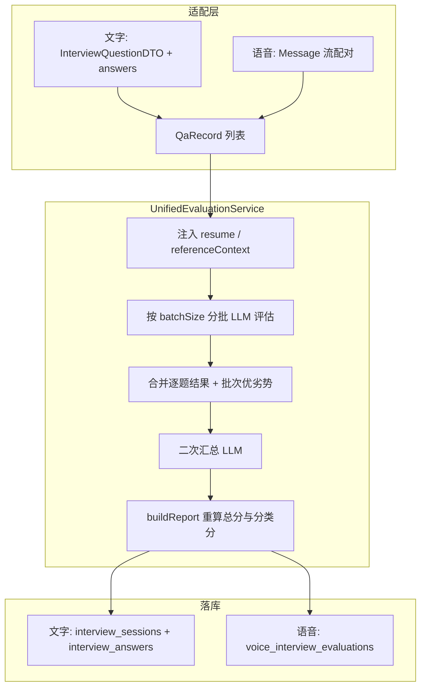
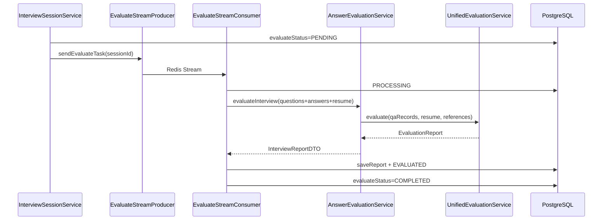
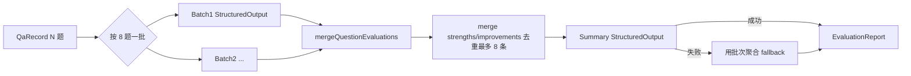

# 第 4 章：统一评估引擎

> 学习目标：理解文字面试与语音面试如何共用同一套「分批评估 → 合并 → 二次汇总 → 落库」流水线；弄清评分维度写在 Prompt 里、总分如何在代码中重算；以及异步 Stream 路径与同步拉报告路径的差异和边界。

## 1. 一句话概括

统一评估引擎把任意形式的「问答列表」转成结构化面试报告：适配层先把文字题单或语音消息归一成 `QaRecord`，核心服务 `UnifiedEvaluationService` 按批次调用 LLM 打分并二次汇总，最后由各业务模块把 `EvaluationReport` 写成自己的表结构。

它解决的不是「再调一次大模型」，而是把**长面试、多题评估**拆成可控的 Token 批次，并在失败时有明确降级，让文字与语音两条产品线共用同一套评分心智与 Prompt。

---

## 2. 设计思路

### 2.1 为什么要「统一」而不是各写一套评估

文字面试的输入是预生成的 `InterviewQuestionDTO` 列表 + 用户答案；语音面试的输入是交错的 ASR/TTS 消息流。两者表面不同，但评估目标相同：

- 逐题分数与反馈
- 分类得分
- 总体评价、优势、改进建议
- 参考答案与关键点

若各自维护 Prompt 与解析逻辑，会出现：

- 评分标准漂移（同一人同一回答，文字和语音分数不可比）
- 结构化输出重试、降级各写一遍
- 改评分维度要改两处

因此项目在 `common.evaluation` 抽出：

| 类型 | 职责 |
|------|------|
| `QaRecord` | 通用问答输入 |
| `EvaluationReport` | 通用报告输出 |
| `UnifiedEvaluationService` | 分批评估 + 二次汇总 + 降级 |
| `InterviewEvaluationProperties` | `batchSize` 与 Prompt 路径 |

业务侧只做适配：

- `AnswerEvaluationService`：文字 DTO ↔ 通用模型
- `VoiceInterviewEvaluationService`：语音消息 → `QaRecord`，再落 `voice_interview_evaluations`

### 2.2 为什么要分批评估

一次面试可能有主问题 + 追问，总题量可到十几二十道；每题还要生成反馈和参考答案。全部塞进一次 Prompt 会：

- 接近上下文窗口上限
- 结构化 JSON 更易截断或字段缺失
- 单次失败成本高（整场重评）

默认 `app.interview.evaluation.batch-size=8`（可用环境变量 `APP_INTERVIEW_EVALUATION_BATCH_SIZE` 覆盖）。每批独立调用 `StructuredOutputInvoker`，一批失败返回 `null`，合并时该批题目按 **0 分 + 提示文案** 兜底，其他批次仍保留。

### 2.3 为什么还要「二次汇总」

每批 LLM 都会产出自己的 `overallFeedback` / `strengths` / `improvements`。简单拼接会出现：

- 同一优点重复出现
- 批次视角割裂，缺少全局结论

因此在合并逐题结果后，再调一次「总结评估」Prompt，输入：

- 类别得分概览
- 题目高亮（题干截断 + 分数 + 反馈摘要）
- 分批初始结论作为 fallback

总结失败则直接使用批次聚合结果，不阻断报告生成。

### 2.4 评分维度在哪里定义

评分标准写在 Prompt，不在 Java 枚举里硬编码权重计算。

`interview-evaluation-system.st` 约定：

| 维度 | 权重 | 含义 |
|------|------|------|
| 准确性 | 40% | 概念是否正确、有无事实错误 |
| 完整性 | 20% | 是否覆盖核心点 |
| 深度 | 25% | 是否触及原理、源码、优化、设计权衡 |
| 表达 | 15% | 逻辑与条理 |

分档：90–100 优秀 … 0–39 较差；并明确「不知道/跳过」等无效回答必须 0 分。

**代码侧总分算法与 Prompt 表述不完全一致（面试要说清楚）：**

- Prompt 写：`overallScore` 应为各题得分的加权平均。
- `buildReport` 实际：对所有题目分数做**算术平均**；未作答题目分数固定为 0，且计入平均。
- 批次 JSON 里的 `overallScore` 字段**不会**进入最终报告，最终分以代码重算为准。

也就是说：维度权重主要约束「单题怎么打分」；最终总分是「各题分数的简单平均」，不是再按 40/20/25/15 做二次加权。

### 2.5 参考答案基线从哪来

评估不只看「模型常识」，还会注入 Skill 的 `references`：

```
InterviewSkillService.buildEvaluationReferenceSectionSafe(skillId)
```

与出题不同：评估阶段**不按题量分配过滤**，覆盖该 Skill 下所有配置了 `ref` 的分类；总长上限 **6000** 字符（出题注入上限是 12000）。Prompt 说明基线用于校准深度与完整性，允许等价正确表述。

简历文本若过长，评估前截断为前 **3000** 字符。

### 2.6 异步与同步双路径（文字面试）

| 路径 | 触发 | 特点 |
|------|------|------|
| 异步主路径 | 答完最后一题 / 提前交卷 → `EvaluateStreamProducer` | 不阻塞用户；`evaluateStatus`: PENDING→PROCESSING→COMPLETED/FAILED；`shouldSkip` 防重复 |
| 同步路径 | `GET /api/interview/sessions/{id}/report` → `generateReport` | 当场调 LLM；写报告并把会话 `status` 置 `EVALUATED` |

两条路径最终都调用 `AnswerEvaluationService.evaluateInterview` → `UnifiedEvaluationService`。

注意：同步 `saveReport` 会更新 `status=EVALUATED` 与分数，但**不一定**把 `evaluateStatus` 标成 `COMPLETED`（该字段主要由 Stream Consumer 的 `markCompleted` 维护）。若异步任务仍在跑，可能出现「报告已有、状态字段仍 PENDING」的短暂或持久不一致——这是当前实现边界。

语音面试以异步为主：结束会话后 `afterCommit` 再入队，避免事务未提交就被消费者读到空数据。

---

## 3. 数据处理流程

### 3.1 总览



### 3.2 文字面试异步评估时序



Consumer 组装数据时：从 `questionsJson` 反序列化题目，再用 `interview_answers` 回填 `userAnswer`，然后按会话保存的 `llmProvider` 取 `ChatClient`。

### 3.3 分批 + 二次汇总内部流程



单批失败时 `evaluateBatch` 捕获异常返回 `null`，`mergeQuestionEvaluations` 为该批每题填充：

- `score = 0`
- `feedback = "该题未成功生成评估结果，系统按 0 分处理。"`

### 3.4 语音面试如何变成 QaRecord

`VoiceInterviewEvaluationService.buildQaRecords` 顺序扫描消息：

1. AI 文本出现 → 记为 pending 问题。
2. 随后用户文本出现 → 组成一对 `QaRecord`。
3. 同条消息既有 AI 又有用户文本 → 直接成对。
4. 只有用户文本 → 问题为空、分类「综合」。
5. 结束仍有 pending 问题 → 记为未回答（`userAnswer=null`）。

分类用关键词启发式：`项目/实习`→项目深挖，`自我介绍`→自我介绍，`职业规划/优缺点`→HR问题，否则→技术问题。**不是** Skill category key，粒度粗于文字面试。

语音评估调用时 `resumeText` 传 `null`，但仍注入 `skillId` 对应的 evaluation references。

---

## 4. 关键代码解析

### 4.1 通用输入输出模型

```6:11:interview-guide-study/app/src/main/java/interview/guide/common/evaluation/QaRecord.java
public record QaRecord(
    int questionIndex,
    String question,
    String category,
    String userAnswer   // null 表示未回答
) {}
```

```8:18:interview-guide-study/app/src/main/java/interview/guide/common/evaluation/EvaluationReport.java
public record EvaluationReport(
    String sessionId,
    int totalQuestions,
    int overallScore,
    List<CategoryScore> categoryScores,
    List<QuestionEvaluation> questionDetails,
    String overallFeedback,
    List<String> strengths,
    List<String> improvements,
    List<ReferenceAnswer> referenceAnswers
)
```

### 4.2 统一评估入口

```100:144:interview-guide-study/app/src/main/java/interview/guide/common/evaluation/UnifiedEvaluationService.java
    public EvaluationReport evaluate(ChatClient chatClient,
                                     String sessionId,
                                     List<QaRecord> qaRecords,
                                     String resumeText,
                                     String referenceContext) {
        // 简历截断 3000、参考基线截断 6000
        List<BatchResult> batchResults = evaluateInBatches(...);
        List<QuestionEvalDTO> mergedEvaluations = mergeQuestionEvaluations(batchResults);
        // ...
        SummaryDTO summary = summarizeBatchResults(...);
        return buildReport(sessionId, qaRecords, mergedEvaluations,
            summary.overallFeedback(), summary.strengths(), summary.improvements());
    }
```

### 4.3 文字适配器：注入 Skill 参考基线

```45:67:interview-guide-study/app/src/main/java/interview/guide/modules/interview/service/AnswerEvaluationService.java
    public InterviewReportDTO evaluateInterview(...) {
        List<QaRecord> qaRecords = questions.stream()
            .map(q -> new QaRecord(q.questionIndex(), q.question(), q.category(), q.userAnswer()))
            .toList();

        String referenceContext = skillService.buildEvaluationReferenceSectionSafe(
            persistenceService.findBySessionId(sessionId).map(s -> s.getSkillId()).orElse(null)
        );

        EvaluationReport report = unifiedEvaluationService.evaluate(
            chatClient, sessionId, qaRecords, resumeText, referenceContext
        );
        return toInterviewReportDTO(report);
    }
```

### 4.4 总分与分类分如何重算

```298:343:interview-guide-study/app/src/main/java/interview/guide/common/evaluation/UnifiedEvaluationService.java
        long answeredCount = qaRecords.stream()
            .filter(q -> q.userAnswer() != null && !q.userAnswer().isBlank())
            .count();
        // ...
        // 未回答：score 强制 0
        int score = hasAnswer && eval != null ? eval.score() : 0;
        // ...
        int overallScore = answeredCount == 0 ? 0
            : (int) questionDetails.stream().mapToInt(QuestionEvaluation::score).average().orElse(0);
```

要点：

- 全部未答 → 总分 0。
- 有作答时，平均分的分母是**全部题目**（含未答 0 分），不是「仅已答题目」。
- 分类分：同 `category` 下各题分数再平均。

### 4.5 Prompt 中的评估约束（节选）

```10:34:interview-guide-study/app/src/main/resources/prompts/interview-evaluation-system.st
# Evaluation Dimensions (评估维度)
| 维度 | 权重 | 评估标准 |
| 准确性 | 40% | ...
| 完整性 | 20% | ...
| 深度 | 25% | ...
| 表达 | 15% | ...
# Constraints
- **无效回答必须给 0 分**：如果候选人回答“不知道”...该题分数必须为 0
```

另需注意：system Prompt 角色写的是「资深 Java 后端…面试官」。评估前端/算法等 Skill 时，角色文案并未随 Skill 切换——这是当前 Prompt 的产品化短板，面试可主动提到并说明可按 `skillId` 加载不同评估 Persona。

### 4.6 报告落库（文字）

`InterviewPersistenceService.saveReport`：

1. 写会话级字段：`overallScore`、`overallFeedback`、`strengthsJson`、`improvementsJson`、`referenceAnswersJson`。
2. `status = EVALUATED`，设置 `completedAt`。
3. 遍历 `questionDetails`，更新或创建 `interview_answers` 的 `score` / `feedback` / `referenceAnswer` / `keyPointsJson`（提前交卷未答的题也会补答案行）。

### 4.7 语音落库与空会话

- 有对话：`saveEvaluationTransactional` 写入独立表 `VoiceInterviewEvaluationEntity`（JSON 字段存逐题与参考答案）。
- 无消息：保存空评估（0 分 + 引导文案），避免前端一直转圈。
- LLM 调用在事务外，仅 DB 写入在 `@Transactional` 内，缩短事务持有时间。

### 4.8 配置项

```yaml
app:
  interview:
    evaluation:
      batch-size: ${APP_INTERVIEW_EVALUATION_BATCH_SIZE:8}
```

Prompt 默认路径：

- `classpath:prompts/interview-evaluation-system.st`
- `classpath:prompts/interview-evaluation-user.st`
- `classpath:prompts/interview-evaluation-summary-system.st`
- `classpath:prompts/interview-evaluation-summary-user.st`

---

## 5. 技术亮点

1. **适配器 + 核心引擎分层**：文字/语音只转换输入输出，评分流水线一处维护。
2. **分批评估降低长上下文风险**：单批失败局部 0 分兜底，不全场报废。
3. **二次汇总提升报告一致性**：先局部后全局，总结失败可降级。
4. **Skill references 校准评分深度**：评估不是纯「印象分」，有知识点基线；基线失败安全降级为空。
5. **结构化输出统一走 `StructuredOutputInvoker`**：与出题、JD 解析同一套重试与 JSON 约束。
6. **异步状态机可观测**：`evaluateStatus` + `evaluateError` 支持历史页/语音页轮询；语音侧 `afterCommit` 入队避免脏读。

---

## 6. 面试问答

### Q1：统一评估引擎的核心流程是什么？

**答：** 适配层把会话变成 `QaRecord` → 截断简历/参考基线 → 按 `batchSize`（默认 8）分批结构化评估 → 合并逐题分数与优劣势 → 二次汇总生成总体评价 → `buildReport` 重算总分与分类分 → 各业务落库。文字走 `AnswerEvaluationService`，语音走 `VoiceInterviewEvaluationService`，核心都是 `UnifiedEvaluationService`。

### Q2：评分维度和总分分别怎么算？

**答：** 单题打分由 Prompt 约束四维权重（准确 40%、完整 20%、深度 25%、表达 15%）。最终总分由代码对各题分数做算术平均；未答记 0 且计入平均。批次返回的 `overallScore` 不用作最终分。

### Q3：为什么文字和语音能共用？

**答：** 差异只在数据形态。统一成 `QaRecord(questionIndex, question, category, userAnswer)` 后，评估与报告结构一致。语音多一步消息配对和粗粒度分类推断；文字多一步简历注入和 Skill category。

### Q4：分批失败怎么办？

**答：** 该批返回空，合并时该批每题 0 分并写明「未成功生成评估」。其他批次结果保留。二次汇总再失败则用批次拼接的 feedback/strengths/improvements。

### Q5：异步评估如何避免重复跑？

**答：** Consumer `shouldSkip`：若 `evaluateStatus == COMPLETED` 则 ACK 跳过。入队前通常先标 `PENDING`。重试是 ACK 后投递新消息并增加 `retryCount`（基础设施第 6 章），因此业务幂等依赖状态字段，而不是消息 ID。

### Q6：同步 `GET .../report` 和异步评估有什么区别？

**答：** 都调同一套评估逻辑。异步不阻塞、用 Stream 与 `evaluateStatus`；同步当场等 LLM，写报告并设 `status=EVALUATED`。同步路径对 `evaluateStatus` 的维护不完整，可能与异步状态字段短暂不一致。

### Q7：参考答案基线起什么作用？

**答：** 把 Skill 的 `references/*.md` 注入评估 Prompt，要求模型按知识点深度校准，但允许等价正确表述，不是唯一标准答案。评估侧上限约 6000 字符；加载失败则无基线继续评。

### Q8：提前交卷未答的题怎么处理？

**答：** `userAnswer` 为空则该题 0 分；`saveReport` 仍会为这些题创建/更新答案行，写入分数、反馈和参考答案，方便报告页完整展示。

### Q9：如果面试官问「你们评估准不准」？

**答：** 这是 LLM-as-Judge，一致性依赖模型与 Prompt，没有人工标注集上的 Cohen’s Kappa 或与专家分的相关性评测。工程上通过分档标准、无效回答 0 分、references 校准和结构化输出降低随意性，但不应声称「客观标准化考试」。

### Q10：可改进点有哪些？

**答：**  
1. 评估 Persona 随 `skillId` 切换，去掉写死的「Java 后端面试官」。  
2. 总分算法与 Prompt 对齐（或改 Prompt 描述为算术平均）。  
3. 同步/异步统一更新 `evaluateStatus`，加评估幂等锁。  
4. 引入评测集与人工抽检；对争议题支持二次复核。  
5. 语音分类改为阶段/Skill category，而不是关键词启发式。

---

## 7. 延伸思考

### 7.1 当前边界一览

| 点 | 现状 |
|----|------|
| 总分 | 代码算术平均 ≠ Prompt「加权平均」表述 |
| 评估 Persona | Prompt 偏 Java 后端，未随 Skill 变化 |
| 双路径状态 | 同步 report 与异步 `evaluateStatus` 可能不一致 |
| 语音分类 | 关键词推断，粗粒度 |
| 语音简历 | 评估时不传简历文本 |
| 批次对齐 | 依赖 LLM 返回的题序与批次长度；缺失则 0 分填补 |
| 可解释性 | 无 Citation 到具体 reference 段落 |

### 7.2 和前后章节的关系

- **第 3 章**：交卷后把 `sessionId` 丢进评估 Stream，本章消费并打分。
- **第 5 章（语音面试）**：结束会话后同样入队，但输入是消息流；评估引擎复用本章。
- **第 6 章**：Stream 模板、重试、`shouldSkip` 是评估异步可靠性的底座。

### 7.3 面试中的准确项目定位

推荐表达：

> 我实现的是文字/语音共用的统一评估引擎：问答归一成 QaRecord，按批次做结构化打分，再二次汇总生成报告；Skill references 作为评分基线；总分由代码按各题分数平均得出。异步走 Redis Stream，同步拉报告走同一套核心服务。我清楚 Prompt 维度权重与最终总分算法的差异，以及评估属于 LLM-as-Judge 而非标准化考试。

不要表达为：

- 「评估分数是严格按 40/20/25/15 加权算出的客观总分」。
- 「文字和语音各有一套完全独立的评分模型」。
- 「评估结果已经过大规模人工标注校准」。
- 「同步拉报告和异步状态机完全一致、绝对幂等」。

---

下一章预告：第 5 章将分析语音面试的 WebSocket 实时链路、ASR/TTS、阶段时长联动，以及结束后如何把对话消息交给本章的统一评估引擎。
