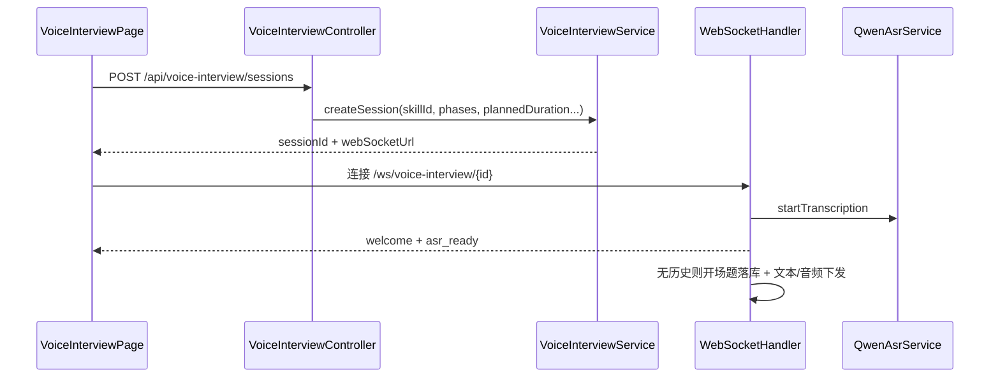
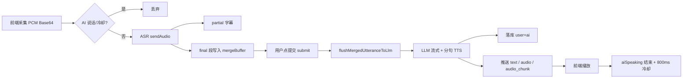
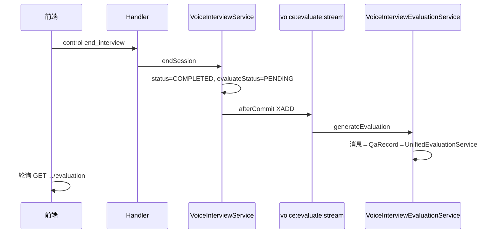

# 第 5 章：语音面试模块

> 学习目标：理解语音面试如何通过 WebSocket 完成「用户音频 → ASR → 手动提交 → LLM → TTS → AI 音频」闭环；弄清阶段配置、暂停超时与评估入队；并准确区分「代码里有阶段切换算法」与「实时链路是否真正自动切阶段」。

## 1. 一句话概括

语音面试模块用 WebSocket 承载实时音视频对话：前端推送 PCM 音频，服务端经 DashScope **Qwen ASR** 转写并合并字幕，用户点击提交后走 **LLM 流式出题 + 分句并发 TTS**，再把 WAV/分块音频推回前端播放；会话结束（或断连兜底）后通过 Redis Stream 接入第 4 章的统一评估引擎。

与文字面试的本质差异：题目不是开场一次性生成，而是**边聊边由语音面试官动态追问**；输入是连续语音流，需要 ASR、回声抑制、人工提交边界和音频播放状态机。

---

## 2. 设计思路

### 2.1 为什么用 WebSocket，而不是一轮一请求的 HTTP

一轮语音对话包含：

1. 持续上行麦克风分片（每秒约数十 KB Base64）
2. 实时字幕（partial / final）
3. 流式 AI 文本
4. 一句或多句 TTS 音频（完整 WAV 或 `audio_chunk`）

若用 HTTP：

- 无法持续推送 partial 字幕与流式文本
- 音频往返延迟叠加严重
- 连接生命周期与「会话状态」难绑定

因此路径为：

```
REST 创建会话 → 拿到 sessionId + wsUrl
→ WebSocket /ws/voice-interview/{sessionId}
→ 全程实时双向消息
→ REST/WS 结束 → Stream 异步评估
```

端点注册在 `WebSocketConfig`：`/ws/voice-interview/{sessionId}`，文本/二进制缓冲上限 2MB。

### 2.2 管线为何是 STT → LLM → TTS

```
麦克风 PCM(16k)
  → Qwen ASR（服务端 VAD 切段）
  → 合并多段定稿字幕
  → 前端手动 submit
  → Voice ChatClient（SkillsTool + 流式 ToolCall）
  → 按句并发 TTS（PCM 24k）
  → 加 WAV 头 / 分块推送
  → 浏览器播放
```

职责拆分：

| 组件 | 职责 |
|------|------|
| `VoiceInterviewWebSocketHandler` | 连接生命周期、消息路由、回声门控、开场、管线编排 |
| `QwenAsrService` | DashScope Realtime ASR 多会话 |
| `DashscopeLlmService` | 构建 Prompt、流式/非流式调用、按句切分 |
| `QwenTtsService` | Realtime TTS 合成 PCM |
| `VoiceInterviewService` | 会话/阶段/消息落库、暂停恢复、评估入队 |
| `VoiceInterviewEvaluationService` | 复用统一评估引擎（第 4 章） |

### 2.3 为什么用户要「手动提交」，而不是说完就自动问下一题

ASR 带服务端 VAD，静音约 2s（配置 `turn-detection-silence-duration-ms`，yaml 默认 2000）会切出一段 final。但候选人思考停顿、补充半句很常见，自动触发 LLM 容易：

- 话没说完就打断
- 多段碎句变成多次提问

当前实现：

1. final 段只进入 `mergeBuffer`，刷新字幕。
2. **前端点提交** → WS `control.action=submit` → `flushMergedUtteranceToLlm`。
3. 可用 `data.text` 覆盖缓冲（允许用户改字幕后再交）。

`application.yml` 里仍有 `user-utterance-debounce-ms` 等防抖项，Handler 注释也提到 debounce；但 `VoiceInterviewProperties` **未绑定这些字段**，实时路径以**手动 submit** 为准。面试时不要说「后端已按 2.5s 防抖自动提交」。

### 2.4 阶段时长联动：有算法，但实时链路未自动驱动

`VoiceInterviewProperties.PhaseConfig` 为 INTRO/TECH/PROJECT/HR 配置：

- `minDuration` / `suggestedDuration` / `maxDuration`（分钟）
- `minQuestions` / `maxQuestions`

`VoiceInterviewService.shouldTransitionToNextPhase` 规则：

1. 达到 `maxDuration` → 应切换
2. 达到 `maxQuestions` → 应切换
3. 达到 `suggestedDuration` 且题数 ≥ `minQuestions` → 应切换

`getNextPhase` 按启用开关跳到下一阶段。

**关键事实：** 上述方法主要在单测/集成测中使用。WebSocket 仅在收到 `start_phase` 时调用 `startPhase`；前端 `VoiceInterviewPage` **未发送** `start_phase`。因此产品上「按计划时长自动切阶段」**尚未接到实时主路径**，当前更多是配置能力 + 可调用 API，真正对话由 LLM 在同一会话里连续追问。

创建会话时会写入 `plannedDuration` 与各阶段 enable 标志，并 `determineFirstPhase` 选起始阶段；开场语按 `skillId` 从 opening 配置选取。

### 2.5 回声与并发：语音系统必须处理的工程问题

- **回声门控**：AI 说话中或结束后 800ms 冷却期内，丢弃麦克风上行，避免扬声器被 ASR 当成用户回答。
- **前端双保险**：`isAiSpeaking` / `isSubmitting` 时不 `sendAudio`。
- **单轮处理锁**：`SessionState.processing` CAS，防止重复 submit 并发跑两路 LLM。
- **ASR 就绪**：连接后等 `asr_ready`；超时自动重连最多 2 次。
- **开场音频缓存**：启动预热常见开场句 TTS，降低首句延迟。
- **虚拟线程**：LLM/TTS/JDBC 跑在 `voicePipelineExecutor`，避免堵死 2 个调度线程。

### 2.6 结束后如何接到统一评估

与文字面试对称：

1. `end_interview` / REST `POST .../end` / 断连兜底 `endSessionIfInProgress`
2. 会话 `COMPLETED`，`evaluateStatus=PENDING`
3. **事务提交后** `VoiceEvaluateStreamProducer` 入队（`afterCommit`，避免消费者读到未提交数据）
4. `VoiceEvaluateStreamConsumer` → `VoiceInterviewEvaluationService.generateEvaluation` → `UnifiedEvaluationService`

另有：5 分钟无活动暂停；定时清理超过 2 小时仍 `IN_PROGRESS` 的僵尸会话；卡在 `PROCESSING` 超过 30 分钟的评估标 `FAILED`。

---

## 3. 数据处理流程

### 3.1 创建到连接



注意：`buildSessionResponse` 里 `webSocketUrl` 目前写死为 `ws://localhost:8080/ws/voice-interview/{id}`。前端实际会按当前 host 重算或使用返回值；生产多实例/HTTPS 需改成相对路径或配置化 `wss://`，这是部署短板。

### 3.2 一轮问答（手动提交）



流式开启时（默认 `llmStreamingEnabled=true`，`chunkedAudioEnabled=true`）：

1. 检测句末标点 → 并发 TTS（每会话信号量默认 3）
2. `OrderedTtsChunkEmitter` 按句序推 `audio_chunk`
3. 全部完成后 `audio_complete`
4. 若分句 TTS 全失败，整段文本兜底一次 TTS

非流式：整段 `chat` → 一次 `synthesize` → 单个 `audio`。

### 3.3 控制面消息

| action | 含义 |
|--------|------|
| `submit` | 提交合并后的用户文本，触发 LLM |
| `end_interview` | 结束会话并入队评估 |
| `start_phase` | 手动切阶段（服务端支持，前端当前未用） |
| `asr_ready` / `asr_reconnecting` | ASR 状态 |
| `pause_timeout_warning` / `pause_timeout` | 4:30 警告 / 5:00 暂停断连 |
| `audio_complete` | 分块播放结束信号 |
| `welcome` | 连接成功 |

上行还有 `type=audio`（Base64 PCM）。下行还有 `subtitle`、`text`、`audio`、`error`。

### 3.4 结束与评估



断连时：若仍为 `IN_PROGRESS`，`endSessionIfInProgress` 自动结束（防状态卡死）；暂停超时走 `pauseSession`，可稍后 `resume`。

---

## 4. 关键代码解析

### 4.1 WebSocket 注册

```23:27:interview-guide-study/app/src/main/java/interview/guide/modules/voiceinterview/config/WebSocketConfig.java
        registry.addHandler(voiceInterviewWebSocketHandler, "/ws/voice-interview/{sessionId}")
                .addInterceptors(new HttpSessionHandshakeInterceptor())
                .setAllowedOrigins(corsProperties.getAllowedOrigins().split(","));
```

### 4.2 连接建立：ASR + 开场

```143:171:interview-guide-study/app/src/main/java/interview/guide/modules/voiceinterview/handler/VoiceInterviewWebSocketHandler.java
    public void afterConnectionEstablished(WebSocketSession session) throws Exception {
        // ... ConcurrentWebSocketSessionDecorator
        startDashScopeStt(sessionId, safeSession);
        sendMessage(safeSession, createWelcomeMessage());
        triggerOpeningQuestionIfNeeded(sessionId, safeSession);
    }
```

开场：无历史消息时，按 `skillId` 取 opening 模板（算法类 Skill 用算法开场，否则后端项目开场），先 `saveMessage` 再推文本/音频。

### 4.3 ASR 结果只合并，不自动调 LLM

```542:569:interview-guide-study/app/src/main/java/interview/guide/modules/voiceinterview/handler/VoiceInterviewWebSocketHandler.java
    private void handleSttResult(String sessionId, String recognizedText, boolean isFinalSegment) {
        if (!isFinalSegment) {
            sendSubtitle(session, state.getMergeBufferPreviewWithPartial(recognizedText), false);
            return;
        }
        if (state.isProcessing().get()) {
            // 丢弃迟到定稿，防污染下一轮
            return;
        }
        state.appendFinalSttSegment(recognizedText);
        sendSubtitle(session, state.getMergeBufferPreview(), false);
    }
```

提交：

```874:885:interview-guide-study/app/src/main/java/interview/guide/modules/voiceinterview/handler/VoiceInterviewWebSocketHandler.java
            case "submit":
                // 可选 data.text 覆盖 mergeBuffer
                flushMergedUtteranceToLlm(sessionId);
                break;
```

### 4.4 LLM：Voice ChatClient + 口语约束

```33:50:interview-guide-study/app/src/main/java/interview/guide/modules/voiceinterview/service/DashscopeLlmService.java
            ChatClient chatClient = llmProviderRegistry.getVoiceChatClient(provider);
            // system: Skill 工具指令 + 语音输出约束 + 可选简历
            // user: 历史对话 + 当前用户输入（经 PromptSanitizer）
```

`VoiceInterviewPromptService` 要求：每轮 1 个主问题、2–4 句、忌 Markdown/代码块；可用 SkillsTool 加载 `SKILL.md`。回复还会 `optimizeForVoice` 截断到约 `aiQuestionMaxChars`（默认 120）句子边界，方便 TTS。

有 `resumeId` 时会查简历文本注入 system prompt；评估阶段反而常不传简历（第 4 章已述），两边不一致可在面试中主动说明。

### 4.5 阶段切换判定（能力已实现，主路径未接）

```442:476:interview-guide-study/app/src/main/java/interview/guide/modules/voiceinterview/service/VoiceInterviewService.java
    public boolean shouldTransitionToNextPhase(...) {
        // maxDuration → true
        // maxQuestions → true
        // suggestedDuration && minQuestions → true
        return false;
    }
```

实时 Handler 不会在每轮 LLM 后调用它；前端也不发 `start_phase`。准确表述应为：「阶段配置与切换判定已实现并通过单测，自动切阶段尚未接入 WebSocket 主循环。」

### 4.6 会话创建与硬编码 WS URL

```76:98:interview-guide-study/app/src/main/java/interview/guide/modules/voiceinterview/service/VoiceInterviewService.java
        VoiceInterviewSessionEntity session = VoiceInterviewSessionEntity.builder()
                .skillId(effectiveSkillId)
                .introEnabled(...)
                .techEnabled(...)
                .projectEnabled(...)
                .hrEnabled(...)
                .plannedDuration(request.getPlannedDuration())
                .currentPhase(determineFirstPhase(request))
                .build();
```

```538:540:interview-guide-study/app/src/main/java/interview/guide/modules/voiceinterview/service/VoiceInterviewService.java
                .webSocketUrl(String.format("ws://localhost:8080/ws/voice-interview/%d", session.getId()))
```

### 4.7 暂停与僵尸清理

- `@Scheduled` 每 30s：无活动 4:30 警告，5:00 `pauseSession` 并关 WS、停 ASR。
- 每 5 分钟：清理启动超过 2 小时仍 `IN_PROGRESS` 的会话；评估 `PROCESSING` 超过 30 分钟标失败。

### 4.8 REST API 一览

| 方法 | 路径 | 说明 |
|------|------|------|
| POST | `/api/voice-interview/sessions` | 创建 |
| GET | `/api/voice-interview/sessions/{id}` | 详情 |
| POST | `/api/voice-interview/sessions/{id}/end` | 结束 + 评估入队 |
| PUT | `.../pause` / `.../resume` | 暂停/恢复 |
| GET | `.../messages` | 历史消息 |
| GET/POST | `.../evaluation` | 轮询状态 / 手动触发评估 |
| GET | `/api/voice-interview/sessions` | 列表 |
| DELETE | `/api/voice-interview/sessions/{id}` | 删除 |

---

## 5. 技术亮点

1. **端到端实时管线**：ASR / LLM / TTS 解耦，Handler 只编排；配置可热重载 ASR/TTS（设置页改 Key 后 `reload`）。
2. **流式文本 + 分句并发 TTS**：降低首音延迟；有序分块发射器保证播放顺序；失败可整段兜底。
3. **回声门控 + 前端双保险**：减少「面试官声音被当成候选人回答」。
4. **手动提交边界**：把 VAD 切段与「一轮作答结束」解耦，更适合面试停顿。
5. **开场预合成缓存 + 虚拟线程**：优化首句体验与线程占用。
6. **结束可靠性**：`afterCommit` 入队、断连自动结束、暂停超时、僵尸会话与卡死评估清理。
7. **评估复用**：消息配对成 `QaRecord` 后走统一评估引擎，与文字面试同评分流水线。

---

## 6. 面试问答

### Q1：语音面试完整链路是什么？

**答：** REST 创建会话 → 连 WebSocket → 启 ASR → 可选开场 TTS → 用户说话推音频 → ASR 出字幕并合并 → 用户提交 → LLM（可流式）生成追问 → 分句 TTS → 前端播放 → 消息落库；结束后面评估 Stream，轮询评估结果。

### Q2：和文字面试最大的三点区别？

**答：**  
1. 交互：WebSocket 实时音视频 vs REST 逐题。  
2. 出题：动态追问 vs 开场批量生成题单。  
3. 配置：`plannedDuration` + 阶段开关 vs `questionCount`；阶段自动切换算法尚未接主路径。

### Q3：如何防止扬声器回声触发 ASR？

**答：** 服务端在 `aiSpeaking` 或结束后 800ms 冷却丢弃上行音频；前端在 AI 播放/提交中也不发音频。仍无法 100% 消除，但能覆盖多数回声尾音。

### Q4：为什么不说完就自动问下一题？

**答：** VAD 静音切段不等于「回答结束」。当前用手动 submit 合并多段 final，避免思考停顿被打断。yaml 里的 debounce 配置尚未接到 `VoiceInterviewProperties` 字段，不能当成已上线能力。

### Q5：流式 TTS 怎么保证顺序？

**答：** LLM 按句回调；每句异步合成，但 `OrderedTtsChunkEmitter` 按 index 顺序 `drain` 再推 `audio_chunk`；全部结束发 `audio_complete`。单句超时可跳过，必要时整段兜底。

### Q6：「阶段时长联动」现在做到哪一步？

**答：** 配置齐全，`shouldTransitionToNextPhase` / `getNextPhase` / `startPhase` 已实现并有单测；WebSocket 支持 `start_phase`；但前端与 Handler 主循环**没有**每轮自动判定并切换。面试应说「能力已具备，自动驱动未接线」，不要说「线上已按分钟自动切 INTRO→TECH」。

### Q7：多实例部署有什么问题？

**答：** ASR/TTS/WS 会话状态在进程内存（`ConcurrentHashMap`）。用户连到实例 A，下一跳到实例 B 会丢会话。需粘性会话或把实时状态外置；评估 Stream 可多实例消费，但实时语音不行。

### Q8：断线会怎样？

**答：** 关连接时停 ASR，清理内存状态；若会话仍 `IN_PROGRESS` 则自动 `endSession` 并可能触发评估。暂停超时则标 `PAUSED`，可从历史恢复。

### Q9：LLM 用的哪类 Client？

**答：** `LlmProviderRegistry.getVoiceChatClient`：带 SkillsTool 与流式 ToolCallingAdvisor，**不加** MessageChatMemoryAdvisor（历史由服务端手动拼进 Prompt）。

### Q10：若被追问生产化短板？

**答：** WS URL 写死 localhost；无鉴权；阶段自动切换未接线；yaml 限流/防抖配置部分未落地；ASR Key 依赖 DashScope；多实例内存会话；评估侧语音分类仍是关键词启发式。

---

## 7. 延伸思考

### 7.1 边界清单

| 点 | 现状 |
|----|------|
| 阶段自动切换 | 算法有，主路径未接 |
| 防抖自动提交 | yaml 有，Properties/Handler 未真正使用 |
| WS URL | 写死 `localhost:8080` |
| 限流 | `rate-limit` 配置存在，WebSocket 未强制执行 |
| 多实例 | 内存会话，需粘性或外置 |
| Docker/文档 | 早期调研曾提到语音 WS 部署差异，以当前代码与 compose 为准核实 |
| 用户体系 | `userId` 固定 `default` |

### 7.2 可演进方向

1. 每轮 LLM 后调用 `shouldTransitionToNextPhase`，通过 WS 通知前端并 `startPhase`。  
2. 把 debounce 配置真正绑到 Properties，支持「自动提交 / 手动提交」双模式。  
3. `webSocketUrl` 改为相对路径或基于 `X-Forwarded-*` / 配置域名生成 `wss`。  
4. Redis 发布订阅或共享 ASR 网关，解决多实例。  
5. 评估时把简历与真实阶段 category 一并传入统一引擎。

### 7.3 与相邻章节

- **第 3 章**：文字面试预生成题单；本章动态追问。  
- **第 4 章**：结束后消息 → `QaRecord` → 统一评估。  
- **第 6 章**：评估 Stream 模板、Provider 热切换（Voice ChatClient）、限流注解（REST 侧）。

### 7.4 面试中的准确项目定位

推荐表达：

> 我做的语音面试是 WebSocket 实时管线：Qwen ASR 转写、手动提交合并发言、Voice ChatClient 流式追问、分句并发 TTS 降首音延迟，并处理回声门控、开场缓存、断连收尾和异步评估。阶段时长配置和切换判定已实现，但自动切阶段还没接到实时主循环，我能说明怎么补上。

不要表达为：

- 「说完自动进入下一阶段 INTRO/TECH/HR」。  
- 「后端已按 debounce 自动提交每一句」。  
- 「任意多实例部署下 WebSocket 会话都无损」。  
- 「和文字面试一样开场就生成完整题库」。

---

下一章预告：若继续补齐，可选第 7 章面试安排模块，或第 8 章前端交互与工程化部署；也可回顾第 6 章通用基础设施。指定章节即可。
