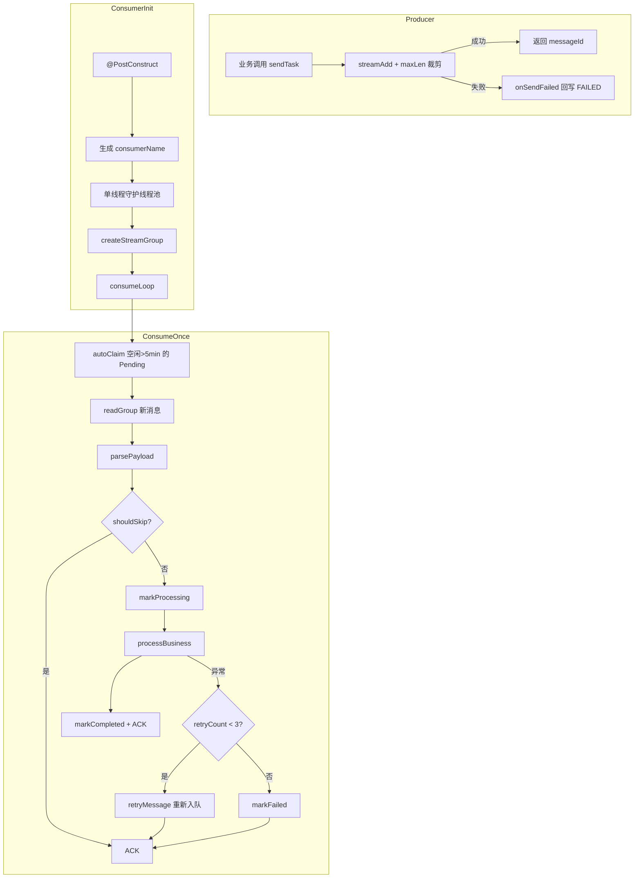
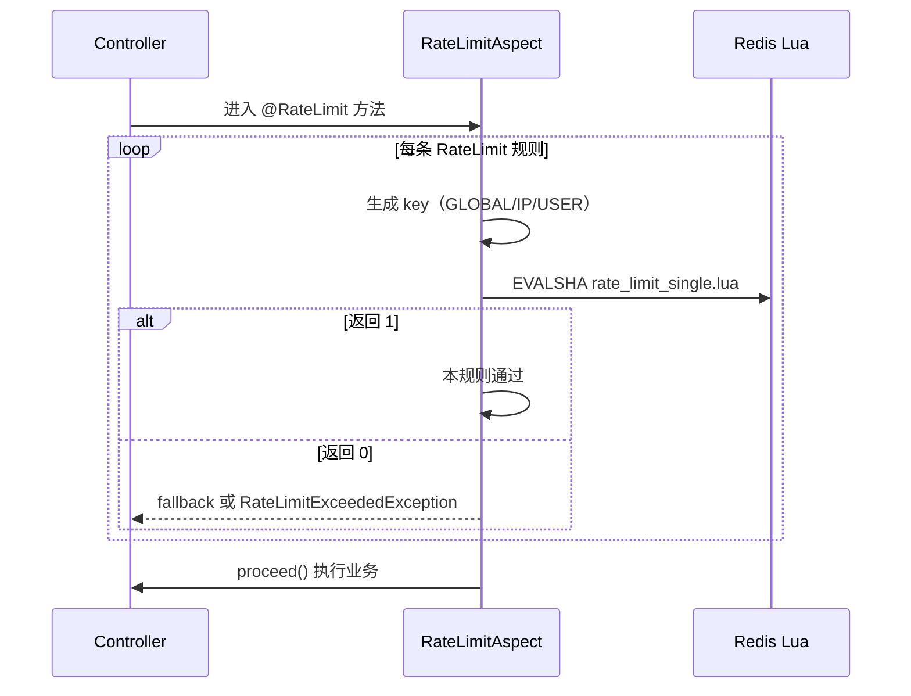
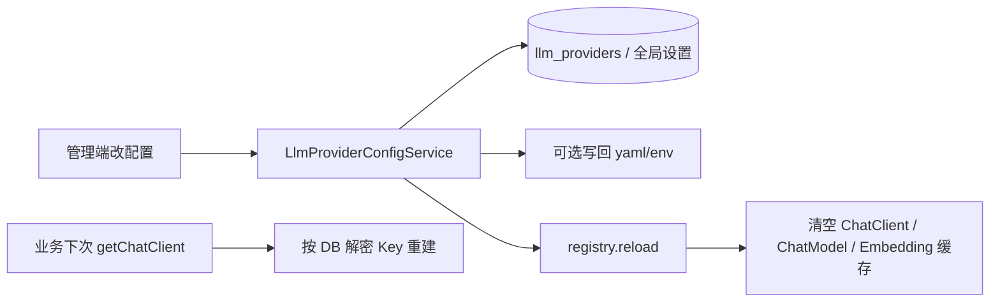

# 第 6 章：通用基础设施

> 学习目标：理解支撑各业务模块的四块底座——Redis Stream 生产者/消费者模板、Lua 滑动窗口限流、多 LLM Provider 管理与热切换、以及统一异常与响应约定。面试时能说明「为什么抽模板、为什么用 Lua、热切换如何做到不重启」。

## 1. 一句话概括

通用基础设施把跨模块的共性能力抽成可复用骨架：异步任务统一走 Redis Stream 模板（含 Pending 回收与重试）、接口限流用 Redisson + Lua 做原子滑动窗口、LLM 通过 `LlmProviderRegistry` 缓存多 Provider 的 `ChatClient`/`EmbeddingModel` 并在配置变更后 `reload()` 热切换、对外 API 一律返回 HTTP 200 + `Result<code,message,data>`，由 `GlobalExceptionHandler` 把业务异常与 AI 网络异常映射成业务错误码。

---

## 2. 设计思路

### 2.1 为什么要有「通用基础设施」这层

项目有四条异步主干：

| Stream Key | 业务 |
|------------|------|
| `resume:analyze:stream` | 简历分析 |
| `knowledgebase:vectorize:stream` | 知识库向量化 |
| `interview:evaluate:stream` | 文字面试评估 |
| `voice:evaluate:stream` | 语音面试评估 |

若每个模块各自写一套「起线程 → 建组 → 读消息 → ACK → 重试」，会出现：

- Pending 回收策略不一致。
- 重试次数、错误截断、ACK 时机各写各的。
- 新增异步任务成本高、容易漏掉崩溃恢复。

因此抽出 `AbstractStreamProducer` / `AbstractStreamConsumer`：业务子类只填「Stream 名、解析载荷、业务处理、状态回写」。

同理，限流、Provider、异常响应也是横切关注点，不适合散落在各 Controller / Service。

### 2.2 为什么异步用 Redis Stream，而不是 `@Async` 或 MQ

| 方案 | 项目中的取舍 |
|------|----------------|
| `@Async` / 线程池 | 进程内，重启丢任务，无 Pending 语义 |
| RabbitMQ / Kafka | 能力更强，但学习/运维成本更高 |
| Redis Stream + Consumer Group | 已依赖 Redis；有 ACK、Pending、`XAUTOCLAIM`；与 Redisson 集成成本低 |

当前规模下，Stream + 最大长度裁剪（`STREAM_MAX_LEN=1000`）足够支撑演示与中小流量。代价是：没有独立死信队列产品化能力、消息幂等要靠业务 `shouldSkip`、多实例靠消费者组分担但要小心重复消费边界。

### 2.3 为什么限流用 Lua，而不是 Java 里 `INCR`

限流是典型「读-改-写」竞争：

1. 读当前令牌。
2. 判断是否够用。
3. 扣减并记录本次请求。

若在 Java 里分多条 Redis 命令完成，并发下会出现超卖。Lua 脚本在 Redis 单线程里**原子执行**，保证判断与扣减不可分割。

项目选用**滑动时间窗口**（ZSET 记录每次请求时间戳），比固定窗口更平滑，避免窗口边界突发。

### 2.4 为什么 Provider 要「注册表 + 热切换」

业务代码不应写死某个厂商 SDK，而应：

```
业务 → LlmProviderRegistry.getXxxChatClient(providerId)
     → 按 DB/配置构建 OpenAI 兼容 ChatModel
```

配置变更（改 Key、换默认 Chat/Embedding、增删 Provider）后调用 `registry.reload()` 清空 `ConcurrentHashMap` 缓存，**下次访问按新配置重建**，无需重启 JVM。

API Key 入库使用 AES-GCM 加密（`ApiKeyEncryptionService`），列表接口只返回脱敏 `maskedApiKey`。

### 2.5 为什么统一「HTTP 200 + 业务码」

`GlobalExceptionHandler` 对业务异常、校验异常、AI 网络异常、未知异常几乎都标 `@ResponseStatus(HttpStatus.OK)`，真正语义放在 `Result.code`。

好处：

- 前端可统一用 `code === 200` 判断成功，不必解析 HTTP 状态分支。
- 网关/代理对 4xx/5xx 的默认行为不会误伤业务可读错误。

代价：

- 监控若只看 HTTP 状态会失真，必须盯业务码或日志。
- 与 REST「资源不存在应 404」的社区惯例不完全一致。

---

## 3. 数据处理流程

### 3.1 Redis Stream 模板生命周期



关键常量（`AsyncTaskStreamConstants`）：

| 常量 | 值 | 含义 |
|------|-----|------|
| `MAX_RETRY_COUNT` | 3 | 业务失败最多再投递 3 次（共最多 4 次处理） |
| `BATCH_SIZE` | 10 | 每批拉取条数 |
| `PENDING_IDLE_TIMEOUT_MS` | 5 分钟 | Pending 空闲后可被 `autoClaim` |
| `POLL_INTERVAL_MS` | 1000 | 阻塞读超时 |
| `STREAM_MAX_LEN` | 1000 | 近似裁剪旧消息 |

**重试语义注意：** 失败时**先 ACK 原消息**，再 `streamAdd` 一条带更大 `retryCount` 的新消息。不是把原消息留在 Pending 里重试。这样 Pending 不会堆积同一条失败消息，但 Stream 里会出现多条「同业务 ID」记录，业务侧必须靠 `shouldSkip`（例如 `evaluateStatus == COMPLETED`）防重复执行。

### 3.2 Lua 限流流程



Lua（`scripts/rate_limit_single.lua`）逻辑摘要：

1. `value_key` 存当前可用令牌数，缺省为 `max_tokens`。
2. `permits_key`（ZSET）按时间戳记录历史请求。
3. 删除 `now - interval` 之前的记录，并把过期令牌加回。
4. 若可用令牌不足 → 返回 `0`；否则扣减、ZADD 本次记录、设 TTL → 返回 `1`。

切面启动时 `scriptLoad`，运行用 `evalSha`；若 Redis 重启导致 `NOSCRIPT`，切面会重新 `loadScript` 再试一次。

### 3.3 Provider 热切换流程



客户端类型：

| 方法 | 用途 |
|------|------|
| `getChatClient` | 默认 Advisors + SkillsTool |
| `getPlainChatClient` | 结构化 JSON 出题/评分，**不带 Tool** |
| `getVoiceChatClient` | 语音面试：SkillsTool + 流式 ToolCall，无 Memory Advisor |
| `getChatClientOrDefault` | `providerId` 空则用默认 Chat Provider |
| `getDefaultEmbeddingModel` | 知识库向量化 |

默认 Provider 解析顺序：`LlmGlobalSettingEntity`（单例行）→ 回退 `app.ai.default-provider`。

### 3.4 异常到统一响应

```
抛出异常
  → GlobalExceptionHandler
  → Result.error(code, message)
  → HTTP 200 + JSON { code, message, data: null }
```

`RateLimitExceededException` 继承 `BusinessException`，错误码 `8001`，走业务异常分支。

---

## 4. 关键代码解析

### 4.1 生产者模板

```22:36:interview-guide-study/app/src/main/java/interview/guide/common/async/AbstractStreamProducer.java
    protected void sendTask(T payload) {
        try {
            String messageId = redisService.streamAdd(
                streamKey(),
                buildMessage(payload),
                AsyncTaskStreamConstants.STREAM_MAX_LEN
            );
            log.info("{}任务已发送到Stream: {}, messageId={}",
                taskDisplayName(), payloadIdentifier(payload), messageId);
        } catch (Exception e) {
            // ...
            onSendFailed(payload, "任务入队失败: " + e.getMessage());
        }
    }
```

子类只需实现：`taskDisplayName`、`streamKey`、`buildMessage`、`payloadIdentifier`、`onSendFailed`。入队失败时由子类把业务状态标为 `FAILED`，避免「库里 PENDING、队列里没有」的黑洞。

### 4.2 消费者模板：骨架 + Pending 回收

```37:57:interview-guide-study/app/src/main/java/interview/guide/common/async/AbstractStreamConsumer.java
    @PostConstruct
    public void init() {
        this.consumerName = consumerPrefix() + UUID.randomUUID().toString().substring(0, 8);
        this.executorService = new ThreadPoolExecutor(
            1, 1, 0L, TimeUnit.MILLISECONDS,
            new LinkedBlockingQueue<>(),
            r -> {
                Thread t = new Thread(r, threadName());
                t.setDaemon(true);
                return t;
            },
            new ThreadPoolExecutor.AbortPolicy()
        );
        running.set(true);
        executorService.submit(this::startConsumer);
    }
```

每个 Consumer Bean **单线程**消费；多实例部署时靠同一 Consumer Group 内不同 `consumerName` 分担。

处理骨架：

```129:150:interview-guide-study/app/src/main/java/interview/guide/common/async/AbstractStreamConsumer.java
        try {
            if (shouldSkip(payload)) {
                ackMessage(messageId);
                return;
            }
            markProcessing(payload);
            processBusiness(payload);
            markCompleted(payload);
            ackMessage(messageId);
        } catch (Exception e) {
            if (retryCount < AsyncTaskStreamConstants.MAX_RETRY_COUNT) {
                retryMessage(payload, retryCount + 1);
            } else {
                markFailed(payload, truncateError(...));
            }
            ackMessage(messageId);
        }
```

`RedisService.streamConsumeMessages`：**先 `autoClaim` Pending，再 `readGroup(neverDelivered)`**。注释还记录了 Redisson 4.0.0 无消息时 `ClassCastException` 的兼容处理。

### 4.3 限流注解与切面

```27:30:interview-guide-study/app/src/main/java/interview/guide/common/annotation/RateLimit.java
@Target(ElementType.METHOD)
@Retention(RetentionPolicy.RUNTIME)
@Repeatable(RateLimit.Container.class)
public @interface RateLimit {
```

可重复注解：同一方法可叠多条规则，**全部通过**才放行。维度：`GLOBAL` / `IP` / `USER`。

**易错点（面试常问）：** `timeUnit` 默认是 **`SECONDS`**，不是分钟。例如：

```java
@RateLimit(dimension = RateLimit.Dimension.GLOBAL, count = 5)
@RateLimit(dimension = RateLimit.Dimension.IP, count = 5)
```

含义是：**全局每秒最多 5 次，且单 IP 每秒最多 5 次**。`ResumeController` 旁有注释曾写「每分钟」，那是错误表述；同文件后续注释已纠正为「默认时间窗口 1 秒」。

Key 设计使用 Hash Tag：`ratelimit:{ClassName:methodName}:ip:x.x.x.x`，便于 Redis Cluster 同槽。

注解里的 `timeout` 字段**切面未使用**，当前始终是「拿不到立刻拒绝」，不是阻塞等令牌。

### 4.4 Lua 脚本核心

```44:60:interview-guide-study/app/src/main/resources/scripts/rate_limit_single.lua
-- 检查可用令牌
if current_val < permits then
    return 0
end

-- 扣减令牌
local permit_record = request_id .. ":" .. permits
redis.call("zadd", permits_key, now_ms, permit_record)
redis.call("set", value_key, current_val - permits)
-- expire = 窗口 * 2
return 1
```

### 4.5 Provider 注册表与 reload

```102:155:interview-guide-study/app/src/main/java/interview/guide/common/ai/LlmProviderRegistry.java
    public ChatClient getChatClient(String providerId) {
        return clientCache.computeIfAbsent(providerId, id -> createChatClient(id));
    }

    public void reload() {
        int size = clientCache.size() + chatModelCache.size() + embeddingModelCache.size();
        clientCache.clear();
        chatModelCache.clear();
        embeddingModelCache.clear();
        log.info("[LlmProviderRegistry] Cache cleared ({} entries). ...", size);
    }
```

配置来源优先数据库：`providerRepository.findById` + `encryptionService.decrypt`；无 Repository 时回退 `LlmProviderProperties`（便于单测）。

`LlmProviderConfigService` 在 create/update/delete/改默认 Chat 或 Embedding 后都会 `registry.reload()`；另提供 `POST /api/llm-provider/reload` 手动触发。写操作包在 `ReentrantReadWriteLock` 写锁中。

**配置与注释不一致：** `application.yml` 中 `default-provider: openrouter`，行内注释仍写「默认提供商为 dashscope」。面试应说「以 yaml/DB 实际值为准，注释可能过时」。

### 4.6 API Key 加密

`ApiKeyEncryptionService`：AES/GCM/NoPadding，12 字节 nonce + 128 bit tag。未配置 `APP_AI_CONFIG_ENCRYPTION_KEY` 时，若允许 fallback 则用开发密钥并打 warn；生产应强制配置。

### 4.7 统一响应与全局异常

```11:53:interview-guide-study/app/src/main/java/interview/guide/common/result/Result.java
public class Result<T> {
    private final Integer code;
    private final String message;
    private final T data;
    // success → code=200；error(ErrorCode) → 业务码
}
```

错误码分段（`ErrorCode`）：

| 段 | 模块 |
|----|------|
| 1xxx / HTTP 风格 400–500 | 通用 |
| 2xxx | 简历 |
| 3xxx | 文字面试 |
| 4xxx | 对象存储 |
| 5xxx | PDF 导出 |
| 6xxx | 知识库 |
| 7xxx | AI 服务 |
| 8xxx | 限流 |
| 9xxx | 面试日程 |
| 10xxx | 语音面试 |
| 11xxx | Provider 管理 |

`GlobalExceptionHandler` 额外把 `ResourceAccessException` / `RestClientException` 映射到 `AI_SERVICE_TIMEOUT`、`AI_API_KEY_INVALID`、`AI_RATE_LIMIT_EXCEEDED` 等，避免把厂商 HTTP 细节直接抛给前端。

### 4.8 相关基础设施（简表）

| 组件 | 作用 |
|------|------|
| `StructuredOutputInvoker` | 结构化 JSON 调用 + 重试修复 Prompt + Micrometer 指标 |
| `PromptSanitizer` / `PromptSecurityConstants` | 用户内容边界与防注入指令 |
| `ApiPathResolver` | 兼容各厂商 OpenAI 风格 baseUrl 路径 |
| `TransactionalExecutor` | Stream 失败回调里开新事务回写状态 |

---

## 5. 技术亮点

1. **模板方法固化异步可靠路径**：Pending `autoClaim`、ACK 时机、重试入队、错误截断（500 字）、`shouldSkip` 钩子，四个业务 Stream 共用一套心智模型。
2. **Lua 原子滑动窗口 + 可重复多维度限流**：GLOBAL/IP/USER 独立 key；`NOSCRIPT` 自动重载脚本。
3. **Provider 注册表按场景拆 Client**：plain / default / voice 避免「结构化输出混 Tool Call」这类隐蔽 bug。
4. **热切换 = 清缓存懒重建**：配置改完 `reload()`，进行中的旧 Client 仍可跑完，新请求拿新配置。
5. **API Key AES-GCM 落库 + 脱敏展示**：管理接口不回传明文。
6. **异常体系统一**：业务码分段清晰；AI 网络错误转成可读业务码；限流走 `8001`。

---

## 6. 面试问答

### Q1：为什么用 Redis Stream 而不是消息队列？

**答：** 项目已依赖 Redis，Stream 提供 Consumer Group、ACK、Pending，足够支撑简历分析、向量化、评估等异步任务。用抽象模板统一四条 Stream，降低运维和代码重复。若以后要跨语言消费、强顺序分区或完善死信，再评估 Kafka/RabbitMQ。

### Q2：Consumer 崩溃了消息会丢吗？

**答：** 读到但未 ACK 的消息留在 Pending。新轮询会 `autoClaim` 空闲超过 5 分钟的 Pending。进程正常失败路径会 ACK 后按 `retryCount` 重新入队；超过 `MAX_RETRY_COUNT` 则 `markFailed`。业务还需 `shouldSkip` 防止重复成功后再次执行。

### Q3：限流为什么必须用 Lua？

**答：** 滑动窗口要「查令牌 → 判断 → 扣减 → 记 ZSET」原子完成。多命令非原子会超卖。Lua 在 Redis 内一次执行返回 0/1。切面用 SHA 调用，Redis 重启脚本丢失时捕获 `NOSCRIPT` 再加载。

### Q4：`@RateLimit(count=5)` 是每分钟 5 次吗？

**答：** 不是。默认 `timeUnit=SECONDS`、`interval=1`，即每秒 5 次。要每分钟需显式 `interval=1, timeUnit=MINUTES`。注释里若写「每分钟」以注解默认值为准。

### Q5：多维度限流怎么组合？

**答：** `@Repeatable`。切面按注解数组逐条执行，任一返回 0 即拒绝。典型用法：全局保护总量 + IP 防单点刷接口。

### Q6：Provider 热切换怎么做？有没有并发问题？

**答：** 改 DB/配置后 `LlmProviderRegistry.reload()` 清空三个缓存 Map。下次 `computeIfAbsent` 按最新配置重建。`LlmProviderConfigService` 用读写锁保护配置写路径。已借出的旧 `ChatClient` 不会被强制中断；这是懒切换，不是全局锁住所有进行中的推理。

### Q7：为什么要有 plain / voice 多种 ChatClient？

**答：** 出题、评分要纯 JSON，挂 SkillsTool 会导致模型发 tool call，结构化解析失败。语音面试要流式 ToolCall、且自己管历史，所以不要 MessageChatMemoryAdvisor。默认 Client 则带完整 Advisors。

### Q8：统一返回 HTTP 200 的利弊？

**答：** 利：前端协议简单，业务错误可读。弊：运维监控要看 `code`；与标准 HTTP 语义不完全一致。限流、校验、AI 超时都是 200 + 业务码（如 8001、400、7002）。

### Q9：API Key 怎么存？

**答：** `ApiKeyEncryptionService` AES-GCM，nonce 与密文分列存储；列表只返回 mask。加密密钥来自配置，开发环境可显式允许 fallback key。

### Q10：如果让你改进这套基础设施，你会做什么？

**答：**  
1. Stream：独立死信 Stream、消费幂等表（业务 ID + 任务类型唯一键）、可配置并发消费者。  
2. 限流：使用注解里的 `timeout`、令牌桶、按用户鉴权后的真实 USER 维度。  
3. Provider：`reload` 时按 providerId 精确失效，避免清掉全部缓存；支持灰度默认 Provider。  
4. 异常：关键资源型 API 可对 404/401 恢复真实 HTTP 状态，便于网关策略。

---

## 7. 延伸思考

### 7.1 当前边界

| 点 | 现状 |
|----|------|
| Stream 裁剪 | `maxLen=1000` 近似裁剪，极端情况下 Pending 消息可能已被 trim（代码有 warn） |
| 重试 | ACK + 新消息，非原消息重投；依赖业务幂等 |
| 单线程 Consumer | 每个任务类型吞吐受单线程限制 |
| 限流 USER | 无登录体系时退化为 `anonymous`，等于弱全局 |
| Provider reload | 全量清缓存，瞬时重建压力 |
| HTTP 200 策略 | 监控与 REST 惯例需额外约定 |
| yaml 注释 | `default-provider` 实际值与注释可能不一致 |

### 7.2 和业务模块的关系

```
Controller  ──@RateLimit──► RateLimitAspect ──Lua──► Redis
     │
     ▼
Service ──► LlmProviderRegistry ──► ChatClient / EmbeddingModel
     │
     ▼
Producer ──► AbstractStreamProducer ──► Redis Stream
                                           │
Consumer ◄── AbstractStreamConsumer ◄──────┘
     │
     ▼
异常 ──► BusinessException / RateLimitExceededException
     ──► GlobalExceptionHandler ──► Result
```

简历、RAG、面试、语音评估都挂在这张网上：换 Provider、限流、异步可靠性、错误码，面试时要能画清楚。

### 7.3 面试中的准确项目定位

推荐表达：

> 我把异步任务抽成 Redis Stream 的 Producer/Consumer 模板，统一 Pending 回收、ACK 和重试入队；用 Redisson 加载 Lua 做多维度滑动窗口限流；用 Registry 缓存多种场景的 ChatClient，配置变更后 reload 热切换；对外统一 Result 与全局异常映射。我清楚默认限流单位是秒、重试是 ACK 后再投递，以及 HTTP 200 + 业务码的取舍。

不要表达为：

- 「用了 Kafka 保证消息不丢」。
- 「限流默认每分钟 5 次」。
- 「热切换会立刻中断所有正在调用的模型请求」。
- 「系统有完整用户级鉴权限流」。

---

下一章预告：若按原大纲继续，可补第 4/5 章（统一评估引擎、语音面试）或第 7 章（面试安排 / 前端部署）；你指定「继续」并说明章节即可。
